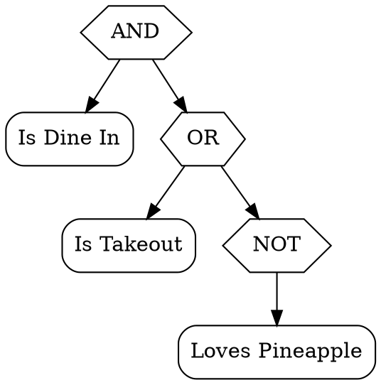
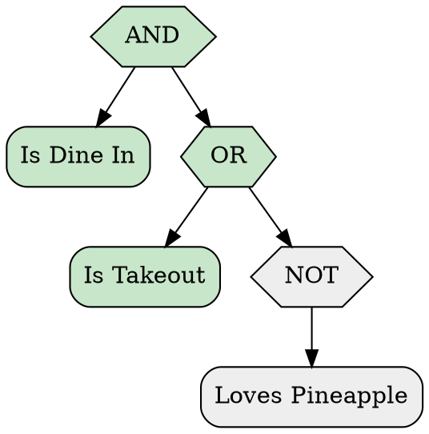

# HTML and Graphviz DOT

How to print a compiled rule as an HTML fragment or as a Graphviz DOT graph. Back to the [README](../README.md).

`CompiledRule<TContext>.PrintHtml` writes the rule as a formula in a web page. `CompiledRule<TContext>.PrintDot` writes the rule as a tree for Graphviz. Both are read views. The canonical rule text does not change. Each printer has an overload that takes a `Decision` and marks the evaluation state of every node.

The examples on this page use this rule:

<!-- doctest:rule pizza -->
```text
isDineIn AND (isTakeout OR NOT lovesPineapple)
```

## HTML

```csharp
string html = rule.PrintHtml();
```

The result is a fragment, not a page. It has one `span` for each node. The class of a `span` tells the role of the node: `tw-operator`, `tw-term` or `tw-constant`. The outer `span` has the class `tw-rule`.

<!-- doctest:html pizza -->
```html
<span class="tw-rule"><span class="tw-term">Is Dine In</span> <span class="tw-operator">AND</span> (<span class="tw-term">Is Takeout</span> <span class="tw-operator">OR</span> <span class="tw-operator">NOT</span> <span class="tw-term">Loves Pineapple</span>)</span>
```

The fragment is safe to put in a page:

- It has no `script` element and no `style` attribute. The host page sets the colors with CSS rules for the classes.
- One escape routine writes every term label, argument value, constant and operator symbol. The characters `&`, `<`, `>`, `"` and `'` become entities, so a term with markup in its name or arguments cannot add an element or an attribute.
- A logic symbol is a named entity, for example `&and;`, and not a raw character.

### HTML options

`HtmlOptions` has four properties. `HtmlOptions.Default` gives the output of the option-less call.

| Property | Meaning | Default |
| --- | --- | --- |
| `OperatorStyle` | `Word`, `Symbolic` or `CStyle` operator spellings. | `Word` |
| `ShowArgumentValues` | Write the argument values after the label of a term. | `true` |
| `SimpleVariables` | Write each term as a letter. The full term stays in the `title` attribute. | `false` |
| `Constants` | How to write `True`, `False` and `Unknown`. See `ConstantFormat`. | `ConstantFormat.Default` |

The symbolic style writes the operators as entities:

<!-- doctest:html pizza symbolic -->
```html
<span class="tw-rule"><span class="tw-term">Is Dine In</span> <span class="tw-operator">&and;</span> (<span class="tw-term">Is Takeout</span> <span class="tw-operator">&or;</span> <span class="tw-operator">&not;</span><span class="tw-term">Loves Pineapple</span>)</span>
```

Simple variables write letters. After the eleventh distinct term, the letters repeat with a subscript, for example `p<sub>1</sub>`:

<!-- doctest:html pizza simple -->
```html
<span class="tw-rule"><span class="tw-term" title="Is Dine In">p</span> <span class="tw-operator">AND</span> (<span class="tw-term" title="Is Takeout">q</span> <span class="tw-operator">OR</span> <span class="tw-operator">NOT</span> <span class="tw-term" title="Loves Pineapple">r</span>)</span>
```

### HTML and a decision

`PrintHtml(decision)` adds a state class to each node: `tw-true`, `tw-false`, `tw-unknown` or `tw-skipped`. A node that short-circuiting skipped has `tw-skipped`. The class goes on the `span` of the node, and an operator node puts it on its symbol.

<!-- doctest:html pizza trace -->
```html
<span class="tw-rule"><span class="tw-term tw-true">Is Dine In</span> <span class="tw-operator tw-true">AND</span> (<span class="tw-term tw-true">Is Takeout</span> <span class="tw-operator tw-true">OR</span> <span class="tw-operator tw-skipped">NOT</span> <span class="tw-term tw-skipped">Loves Pineapple</span>)</span>
```

## Graphviz DOT

```csharp
string dot = rule.PrintDot();
```

The result is a `digraph`. Each operator has an edge to each of its operands. The node ids are `n0`, `n1` and so on, in depth-first order, so the same rule always gets the same ids. The shapes follow the same rule as the Mermaid printer: a hexagon for an operator, a rounded box for a term and a circle for a constant.

<!-- doctest:dot pizza -->


Every label is a quoted DOT string. The printer escapes a backslash, a double quote and a line break, so a term cannot end its label early. To draw the graph, pass the text to Graphviz, for example `dot -Tsvg`.

### DOT options

`DotOptions` has five properties. `DotOptions.Default` gives the output of the option-less call.

| Property | Meaning | Default |
| --- | --- | --- |
| `Direction` | The layout direction (`rankdir`). It uses `MermaidDirection`. | `TopDown` |
| `NodeShapes` | A shape for each node role. When `false`, every node is a plain box. | `true` |
| `OperatorStyle` | `Word`, `Symbolic` or `CStyle` operator spellings. | `Word` |
| `ShowArgumentValues` | Write the argument values in the label of a term. | `true` |
| `Constants` | How to write `True`, `False` and `Unknown`. See `ConstantFormat`. | `ConstantFormat.Default` |

### DOT and a decision

`PrintDot(decision)` fills each node by its state: green for `True`, red for `False`, yellow for `Unknown` and gray for a skipped node.

<!-- doctest:dot pizza trace -->

