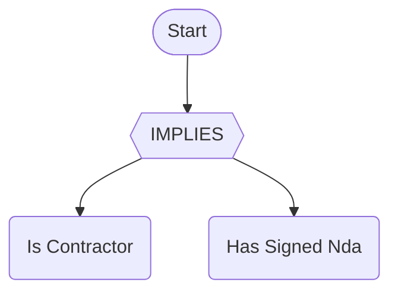
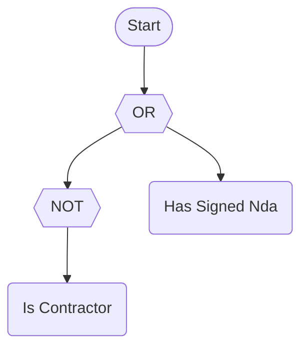
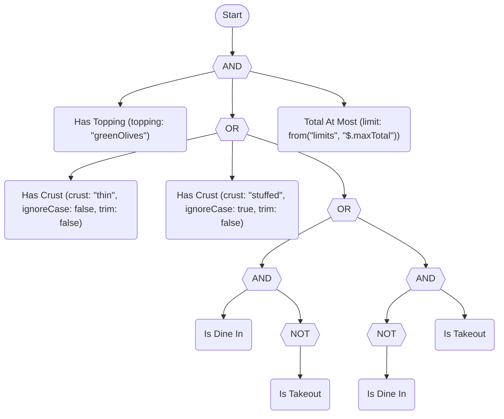
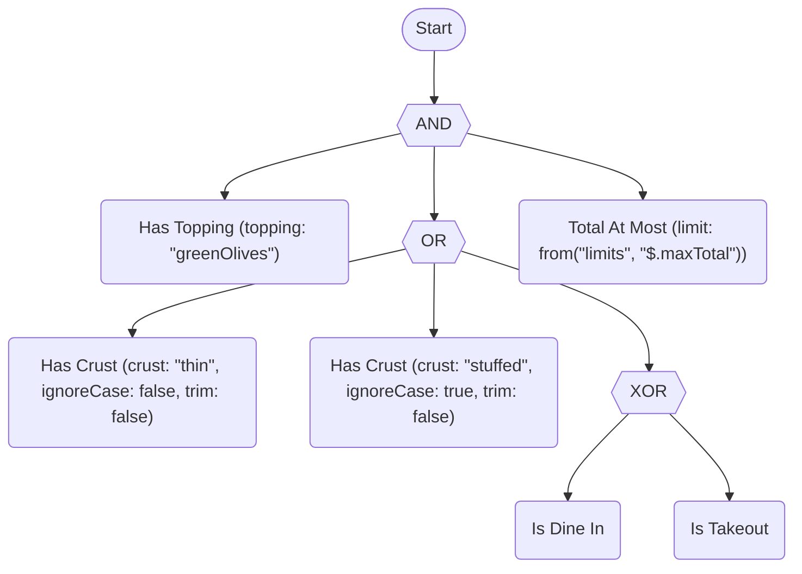
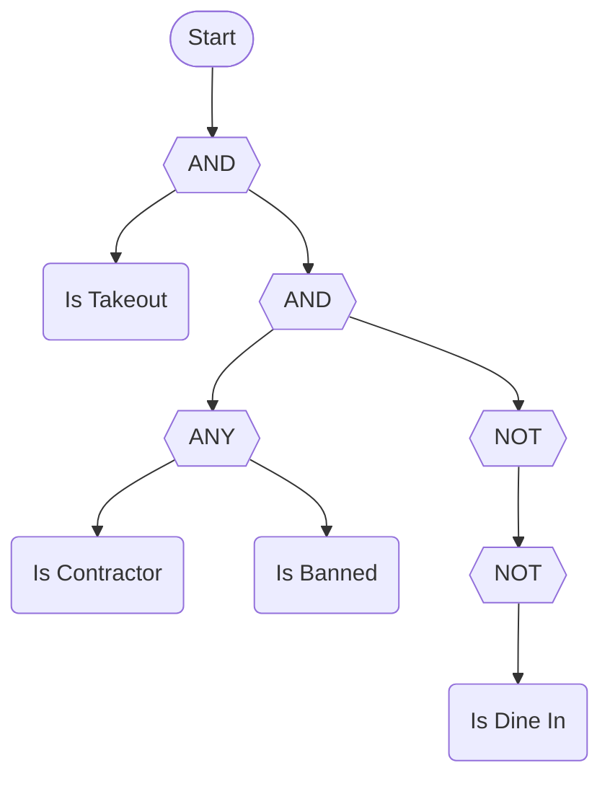
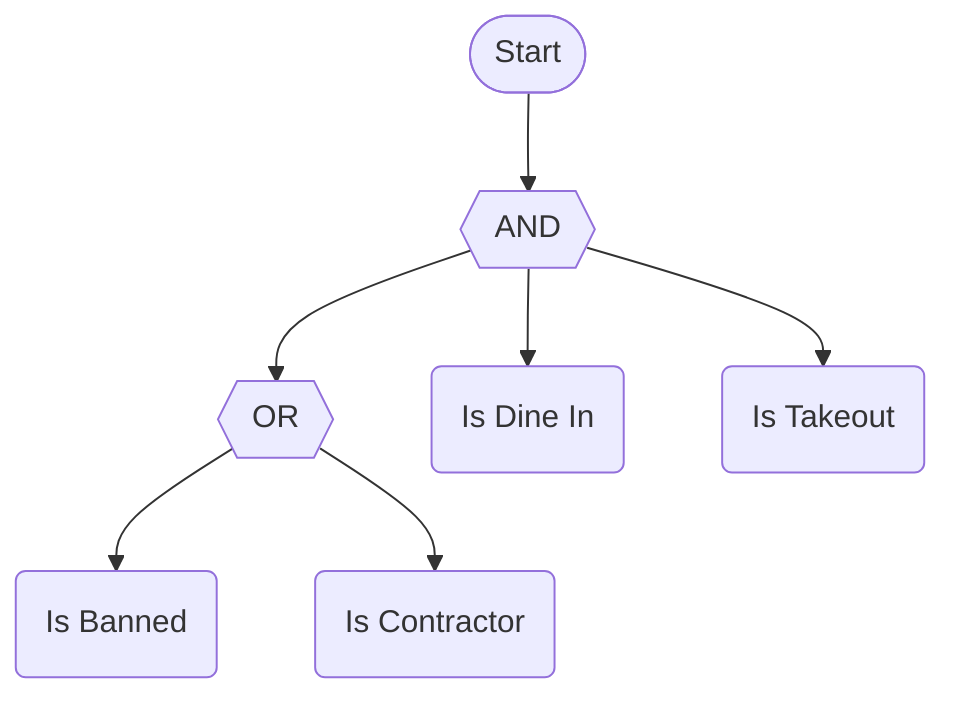
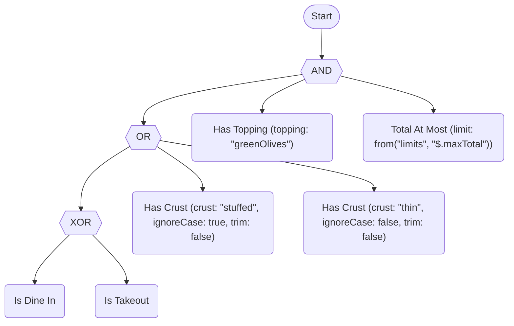
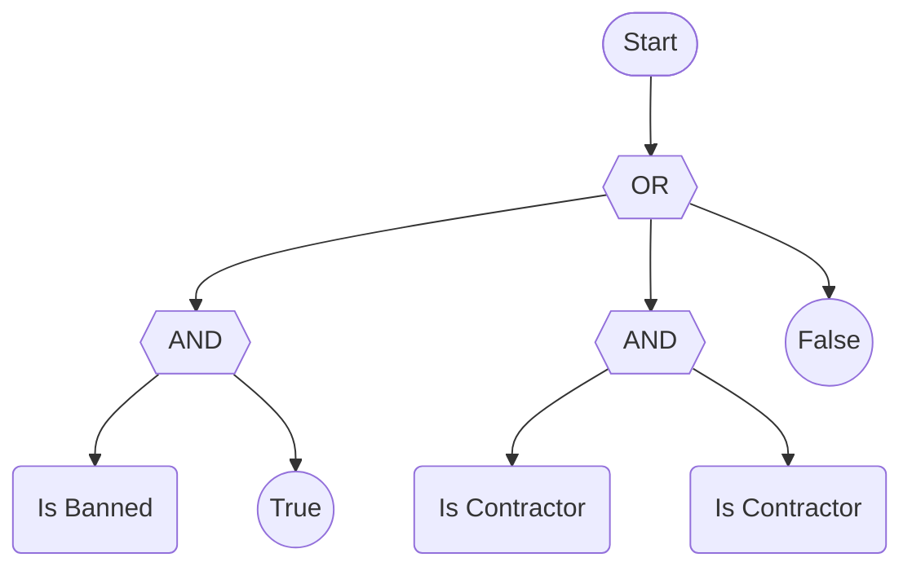
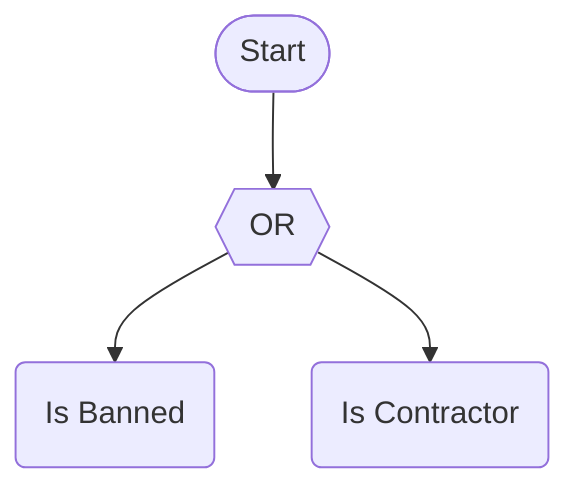

# Rewriting examples

Before and after examples for `ExpandToPrimitives()`, `CompressToDerived()`, `Canonicalize()` and `Simplify()`. Each example shows one rule in four notations. [Rewriting rules and rule equivalence](rewriting-rules.md) describes what each rewrite does and where it stops. The examples for the normal forms are in [Normal form examples](rewriting-normal-form-examples.md). Back to the [README](../README.md).

## The rules in the examples

The examples use the worked rule from [Examples](examples.md#5-the-full-worked-example-in-all-four-forms). It has a class-based predicate (`isDineIn` and `isTakeout`), delegate predicates (`hasTopping`, `hasCrust` and `totalAtMost`) and a data-source variable (`from("limits", "$.maxTotal")`). Each section also uses one small rule that shows the change in a few nodes.

<!-- doctest:rule worked -->
```text
hasTopping(topping: "greenOlives") AND (hasCrust(crust: "thin") OR hasCrust(crust: "stuffed", ignoreCase: true) OR (isDineIn XOR isTakeout)) AND totalAtMost(limit: from("limits", "$.maxTotal"))
```

Every result is shown in four notations. The library prints each one, and a test compares the text on every build.

| Notation | Printer |
| --- | --- |
| Word text | `PrintRuleText()`. The canonical text, which compiles back to the same rule. |
| Symbolic text and Unicode | `PrintEquation()`. One line with `∧`, `∨`, `¬` and `⊕`. |
| Mermaid | `PrintMermaid(new MermaidOptions { NodeShapes = true })`. An operator is a hexagon, a term is a rounded box and a constant is a circle. |
| MathJax | `PrintEquation()` with the LaTeX dialect and the `$$` wrap. A Markdown renderer with math support draws it. |

`OperatorStyle.Symbolic` and `OperatorStyle.CStyle` change only the operator labels of `PrintPlainText` and `PrintMermaid`. No printer writes them as one line. The symbolic text of a rule is therefore the Unicode equation. [Operator styles and simple variables](examples.md#operator-styles-and-simple-variables) lists the symbols.

The worked rule, before any rewrite:

<details>
<summary>Show the four notations</summary>

Word text:

<!-- doctest:ruletext worked -->
```text
hasTopping(topping: "greenOlives") AND (hasCrust(crust: "thin", ignoreCase: false, trim: false) OR hasCrust(crust: "stuffed", ignoreCase: true, trim: false) OR (isDineIn XOR isTakeout)) AND totalAtMost(limit: from("limits", "$.maxTotal"))
```

Symbolic text and Unicode:

<!-- doctest:equation worked -->
```text
hasTopping(topping: "greenOlives") ∧ (hasCrust(crust: "thin", ignoreCase: false, trim: false) ∨ hasCrust(crust: "stuffed", ignoreCase: true, trim: false) ∨ (isDineIn ⊕ isTakeout)) ∧ totalAtMost(limit: from("limits", "$.maxTotal"))
```

Mermaid:

<!-- doctest:mermaid worked shapes -->


MathJax:

<!-- doctest:equation worked latex double-dollar -->
$$\text{hasTopping(topping: "greenOlives")} \land (\text{hasCrust(crust: "thin", ignoreCase: false, trim: false)} \lor \text{hasCrust(crust: "stuffed", ignoreCase: true, trim: false)} \lor (\text{isDineIn} \oplus \text{isTakeout})) \land \text{totalAtMost(limit: from("limits", "\$.maxTotal"))}$$

</details>

## Example: expand to primitives

The small rule is an implication:

<!-- doctest:rule imp -->
```text
isContractor IMPLIES hasSignedNda
```

Word text:

<!-- doctest:ruletext imp -->
```text
(isContractor IMPLIES hasSignedNda)
```

Symbolic text and Unicode:

<!-- doctest:equation imp -->
```text
isContractor → hasSignedNda
```

Mermaid:

<!-- doctest:mermaid imp shapes -->


MathJax:

<!-- doctest:equation imp latex double-dollar -->
$$\text{isContractor} \rightarrow \text{hasSignedNda}$$

`ExpandToPrimitives()` writes `IMPLIES` as `NOT ... OR ...`:

Word text:

<!-- doctest:ruletext imp primitives -->
```text
NOT isContractor OR hasSignedNda
```

Symbolic text and Unicode:

<!-- doctest:equation imp primitives -->
```text
¬isContractor ∨ hasSignedNda
```

Mermaid:

<!-- doctest:mermaid imp shapes primitives -->


MathJax:

<!-- doctest:equation imp primitives latex double-dollar -->
$$\lnot \text{isContractor} \lor \text{hasSignedNda}$$

The worked rule has an `XOR`. The expansion writes it as two `AND` groups under an `OR`:

<details>
<summary>Show the four notations</summary>

Word text:

<!-- doctest:ruletext worked primitives -->
```text
hasTopping(topping: "greenOlives") AND (hasCrust(crust: "thin", ignoreCase: false, trim: false) OR hasCrust(crust: "stuffed", ignoreCase: true, trim: false) OR ((isDineIn AND NOT isTakeout) OR (NOT isDineIn AND isTakeout))) AND totalAtMost(limit: from("limits", "$.maxTotal"))
```

Symbolic text and Unicode:

<!-- doctest:equation worked primitives -->
```text
hasTopping(topping: "greenOlives") ∧ (hasCrust(crust: "thin", ignoreCase: false, trim: false) ∨ hasCrust(crust: "stuffed", ignoreCase: true, trim: false) ∨ ((isDineIn ∧ ¬isTakeout) ∨ (¬isDineIn ∧ isTakeout))) ∧ totalAtMost(limit: from("limits", "$.maxTotal"))
```

Mermaid:

<!-- doctest:mermaid worked shapes primitives -->


MathJax:

<!-- doctest:equation worked primitives latex double-dollar -->
$$\text{hasTopping(topping: "greenOlives")} \land (\text{hasCrust(crust: "thin", ignoreCase: false, trim: false)} \lor \text{hasCrust(crust: "stuffed", ignoreCase: true, trim: false)} \lor ((\text{isDineIn} \land \lnot \text{isTakeout}) \lor (\lnot \text{isDineIn} \land \text{isTakeout}))) \land \text{totalAtMost(limit: from("limits", "\$.maxTotal"))}$$

</details>

## Example: compress to derived operators

The small rule is the primitive form of an implication:

<!-- doctest:rule cmp -->
```text
NOT isContractor OR hasSignedNda
```

Word text:

<!-- doctest:ruletext cmp -->
```text
NOT isContractor OR hasSignedNda
```

Symbolic text and Unicode:

<!-- doctest:equation cmp -->
```text
¬isContractor ∨ hasSignedNda
```

Mermaid:

<!-- doctest:mermaid cmp shapes -->


MathJax:

<!-- doctest:equation cmp latex double-dollar -->
$$\lnot \text{isContractor} \lor \text{hasSignedNda}$$

`CompressToDerived()` recognizes the shape and writes `IMPLIES`:

Word text:

<!-- doctest:ruletext cmp compress -->
```text
(isContractor IMPLIES hasSignedNda)
```

Symbolic text and Unicode:

<!-- doctest:equation cmp compress -->
```text
isContractor → hasSignedNda
```

Mermaid:

<!-- doctest:mermaid cmp shapes compress -->


MathJax:

<!-- doctest:equation cmp compress latex double-dollar -->
$$\text{isContractor} \rightarrow \text{hasSignedNda}$$

Expanding the worked rule to primitives and then compressing it gives back the `XOR`. The [expanded form](#example-expand-to-primitives) is the starting point:

<details>
<summary>Show the four notations</summary>

Word text:

<!-- doctest:ruletext worked primitives compress -->
```text
hasTopping(topping: "greenOlives") AND (hasCrust(crust: "thin", ignoreCase: false, trim: false) OR hasCrust(crust: "stuffed", ignoreCase: true, trim: false) OR (isDineIn XOR isTakeout)) AND totalAtMost(limit: from("limits", "$.maxTotal"))
```

Symbolic text and Unicode:

<!-- doctest:equation worked primitives compress -->
```text
hasTopping(topping: "greenOlives") ∧ (hasCrust(crust: "thin", ignoreCase: false, trim: false) ∨ hasCrust(crust: "stuffed", ignoreCase: true, trim: false) ∨ (isDineIn ⊕ isTakeout)) ∧ totalAtMost(limit: from("limits", "$.maxTotal"))
```

Mermaid:

<!-- doctest:mermaid worked shapes primitives compress -->


MathJax:

<!-- doctest:equation worked primitives compress latex double-dollar -->
$$\text{hasTopping(topping: "greenOlives")} \land (\text{hasCrust(crust: "thin", ignoreCase: false, trim: false)} \lor \text{hasCrust(crust: "stuffed", ignoreCase: true, trim: false)} \lor (\text{isDineIn} \oplus \text{isTakeout})) \land \text{totalAtMost(limit: from("limits", "\$.maxTotal"))}$$

</details>

## Example: canonical form

The small rule has an `ANY`, a double negation and operands in no fixed order:

<!-- doctest:rule can -->
```text
isTakeout AND (ANY(isContractor, isBanned) AND NOT NOT isDineIn)
```

Word text:

<!-- doctest:ruletext can -->
```text
isTakeout AND (ANY(isContractor, isBanned) AND NOT NOT isDineIn)
```

Symbolic text and Unicode:

<!-- doctest:equation can -->
```text
isTakeout ∧ (ANY(isContractor, isBanned) ∧ ¬¬isDineIn)
```

Mermaid:

<!-- doctest:mermaid can shapes -->


MathJax:

<!-- doctest:equation can latex double-dollar -->
$$\text{isTakeout} \land (\text{ANY}(\text{isContractor}, \text{isBanned}) \land \lnot \lnot \text{isDineIn})$$

`Canonicalize()` writes `ANY` as `OR`, removes `NOT NOT`, splices the inner `AND` into the outer one and sorts the operands by their canonical text:

Word text:

<!-- doctest:ruletext can canonicalize -->
```text
(isBanned OR isContractor) AND isDineIn AND isTakeout
```

Symbolic text and Unicode:

<!-- doctest:equation can canonicalize -->
```text
(isBanned ∨ isContractor) ∧ isDineIn ∧ isTakeout
```

Mermaid:

<!-- doctest:mermaid can shapes canonicalize -->


MathJax:

<!-- doctest:equation can canonicalize latex double-dollar -->
$$(\text{isBanned} \lor \text{isContractor}) \land \text{isDineIn} \land \text{isTakeout}$$

In the worked rule, the sort puts the `OR` group first, because `(` sorts before a letter. Inside the group, the `XOR` comes first and the `stuffed` term comes before the `thin` term:

<details>
<summary>Show the four notations</summary>

Word text:

<!-- doctest:ruletext worked canonicalize -->
```text
((isDineIn XOR isTakeout) OR hasCrust(crust: "stuffed", ignoreCase: true, trim: false) OR hasCrust(crust: "thin", ignoreCase: false, trim: false)) AND hasTopping(topping: "greenOlives") AND totalAtMost(limit: from("limits", "$.maxTotal"))
```

Symbolic text and Unicode:

<!-- doctest:equation worked canonicalize -->
```text
((isDineIn ⊕ isTakeout) ∨ hasCrust(crust: "stuffed", ignoreCase: true, trim: false) ∨ hasCrust(crust: "thin", ignoreCase: false, trim: false)) ∧ hasTopping(topping: "greenOlives") ∧ totalAtMost(limit: from("limits", "$.maxTotal"))
```

Mermaid:

<!-- doctest:mermaid worked shapes canonicalize -->


MathJax:

<!-- doctest:equation worked canonicalize latex double-dollar -->
$$((\text{isDineIn} \oplus \text{isTakeout}) \lor \text{hasCrust(crust: "stuffed", ignoreCase: true, trim: false)} \lor \text{hasCrust(crust: "thin", ignoreCase: false, trim: false)}) \land \text{hasTopping(topping: "greenOlives")} \land \text{totalAtMost(limit: from("limits", "\$.maxTotal"))}$$

</details>

## Example: simplify

The small rule has an identity constant, a repeated operand and an `OR` with `False`:

<!-- doctest:rule simp -->
```text
(isBanned AND True) OR (isContractor AND isContractor) OR False
```

Word text:

<!-- doctest:ruletext simp -->
```text
(isBanned AND True) OR (isContractor AND isContractor) OR False
```

Symbolic text and Unicode:

<!-- doctest:equation simp -->
```text
(isBanned ∧ True) ∨ (isContractor ∧ isContractor) ∨ False
```

Mermaid:

<!-- doctest:mermaid simp shapes -->


MathJax:

<!-- doctest:equation simp latex double-dollar -->
$$(\text{isBanned} \land \text{True}) \lor (\text{isContractor} \land \text{isContractor}) \lor \text{False}$$

`Simplify()` removes the `True`, the repeat and the `False`:

Word text:

<!-- doctest:ruletext simp simplify -->
```text
isBanned OR isContractor
```

Symbolic text and Unicode:

<!-- doctest:equation simp simplify -->
```text
isBanned ∨ isContractor
```

Mermaid:

<!-- doctest:mermaid simp shapes simplify -->


MathJax:

<!-- doctest:equation simp simplify latex double-dollar -->
$$\text{isBanned} \lor \text{isContractor}$$

The worked rule has nothing to remove. `Simplify()` returns its canonical form, the same rule that `Canonicalize()` returns:

<details>
<summary>Show the four notations</summary>

Word text:

<!-- doctest:ruletext worked simplify -->
```text
((isDineIn XOR isTakeout) OR hasCrust(crust: "stuffed", ignoreCase: true, trim: false) OR hasCrust(crust: "thin", ignoreCase: false, trim: false)) AND hasTopping(topping: "greenOlives") AND totalAtMost(limit: from("limits", "$.maxTotal"))
```

Symbolic text and Unicode:

<!-- doctest:equation worked simplify -->
```text
((isDineIn ⊕ isTakeout) ∨ hasCrust(crust: "stuffed", ignoreCase: true, trim: false) ∨ hasCrust(crust: "thin", ignoreCase: false, trim: false)) ∧ hasTopping(topping: "greenOlives") ∧ totalAtMost(limit: from("limits", "$.maxTotal"))
```

Mermaid:

<!-- doctest:mermaid worked shapes simplify -->


MathJax:

<!-- doctest:equation worked simplify latex double-dollar -->
$$((\text{isDineIn} \oplus \text{isTakeout}) \lor \text{hasCrust(crust: "stuffed", ignoreCase: true, trim: false)} \lor \text{hasCrust(crust: "thin", ignoreCase: false, trim: false)}) \land \text{hasTopping(topping: "greenOlives")} \land \text{totalAtMost(limit: from("limits", "\$.maxTotal"))}$$

</details>
