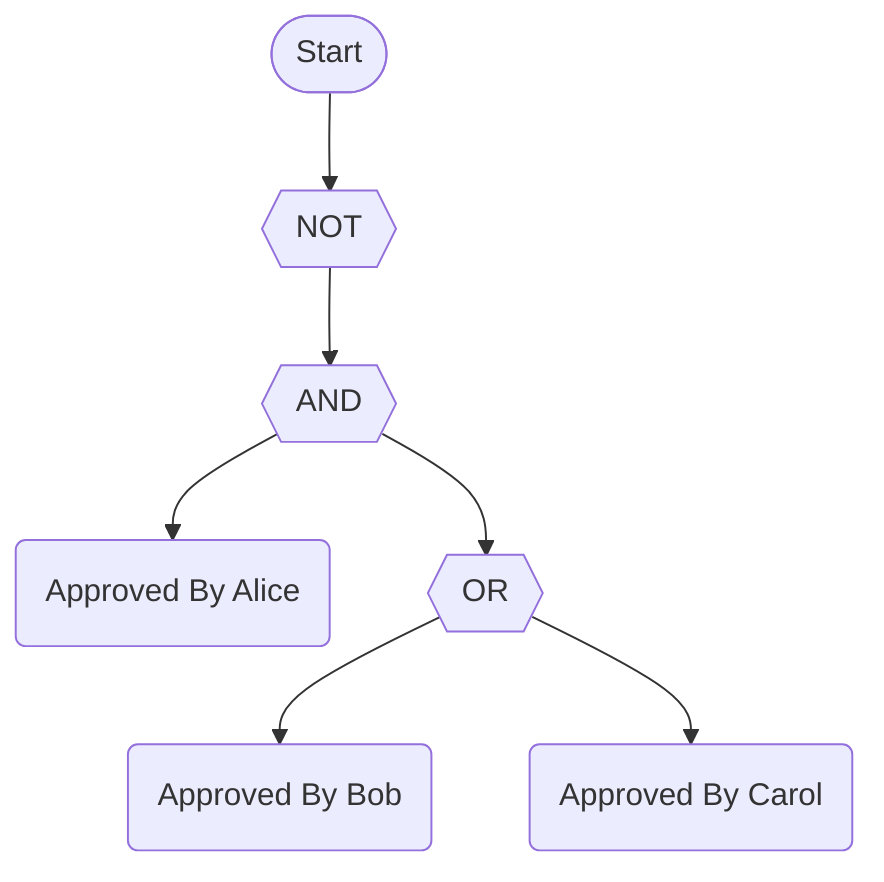
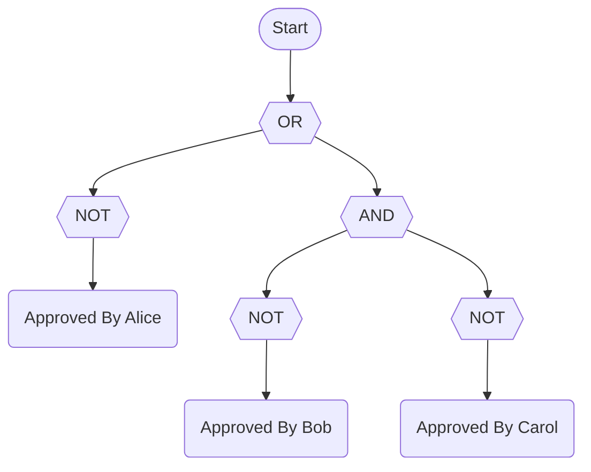
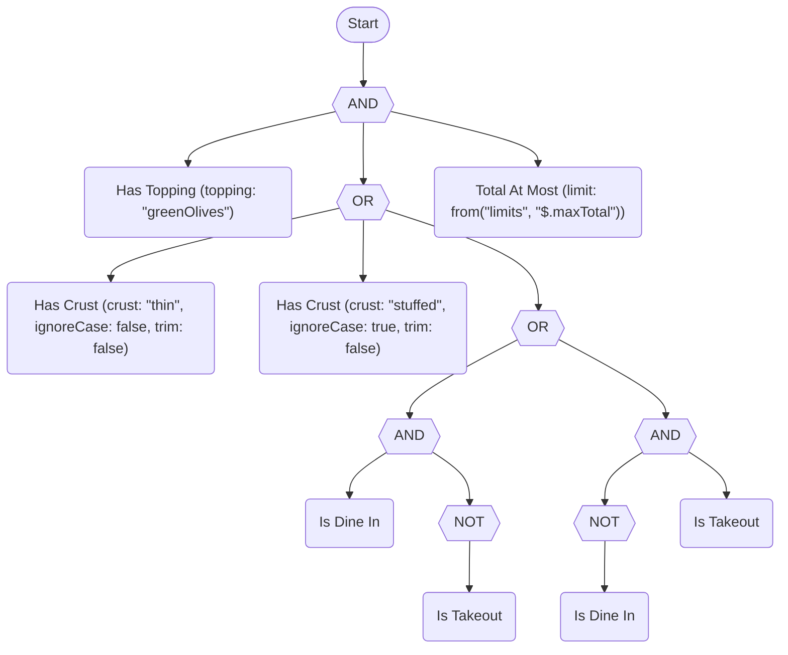
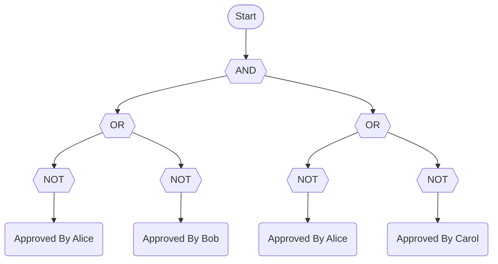
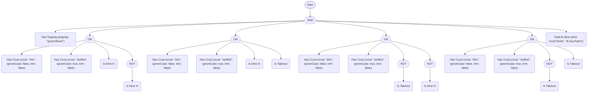
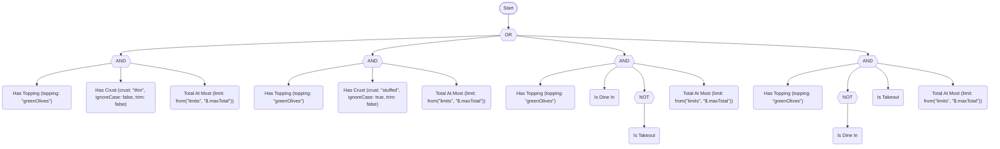

# Normal form examples

Before and after examples for `ToNnf()`, `ToCnf()` and `ToDnf()`, and the size of each result. [Rewriting rules and rule equivalence](rewriting-rules.md#normal-forms) describes the normal forms, the `ExpandThresholds` option and the size cap. The examples for the other rewrites are in [Rewriting examples](rewriting-examples.md). Back to the [README](../README.md).

The larger examples use the worked rule from [Examples](examples.md#5-the-full-worked-example-in-all-four-forms). [Rewriting examples](rewriting-examples.md#the-rules-in-the-examples) shows it in four notations. Each section also uses one small rule.

<!-- doctest:rule worked -->
```text
hasTopping(topping: "greenOlives") AND (hasCrust(crust: "thin") OR hasCrust(crust: "stuffed", ignoreCase: true) OR (isDineIn XOR isTakeout)) AND totalAtMost(limit: from("limits", "$.maxTotal"))
```

## Example: the three forms

The small rule has a `NOT` above an `AND` that holds an `OR`:

<!-- doctest:rule nf -->
```text
NOT (approvedByAlice AND (approvedByBob OR approvedByCarol))
```

Word text:

<!-- doctest:ruletext nf -->
```text
NOT (approvedByAlice AND (approvedByBob OR approvedByCarol))
```

Symbolic text and Unicode:

<!-- doctest:equation nf -->
```text
¬(approvedByAlice ∧ (approvedByBob ∨ approvedByCarol))
```

Mermaid:

<!-- doctest:mermaid nf shapes -->


MathJax:

<!-- doctest:equation nf latex double-dollar -->
$$\lnot (\text{approvedByAlice} \land (\text{approvedByBob} \lor \text{approvedByCarol}))$$

### Negation normal form

`ToNnf()` moves each `NOT` down to a term. De Morgan's laws turn `NOT (a AND b)` into `NOT a OR NOT b`. A derived operator expands first, so the `XOR` of the worked rule becomes two `AND` groups under an `OR`.

Word text:

<!-- doctest:ruletext nf nnf -->
```text
NOT approvedByAlice OR (NOT approvedByBob AND NOT approvedByCarol)
```

Symbolic text and Unicode:

<!-- doctest:equation nf nnf -->
```text
¬approvedByAlice ∨ (¬approvedByBob ∧ ¬approvedByCarol)
```

Mermaid:

<!-- doctest:mermaid nf shapes nnf -->


MathJax:

<!-- doctest:equation nf nnf latex double-dollar -->
$$\lnot \text{approvedByAlice} \lor (\lnot \text{approvedByBob} \land \lnot \text{approvedByCarol})$$

The worked rule:

<details>
<summary>Show the four notations</summary>

Word text:

<!-- doctest:ruletext worked nnf -->
```text
hasTopping(topping: "greenOlives") AND (hasCrust(crust: "thin", ignoreCase: false, trim: false) OR hasCrust(crust: "stuffed", ignoreCase: true, trim: false) OR ((isDineIn AND NOT isTakeout) OR (NOT isDineIn AND isTakeout))) AND totalAtMost(limit: from("limits", "$.maxTotal"))
```

Symbolic text and Unicode:

<!-- doctest:equation worked nnf -->
```text
hasTopping(topping: "greenOlives") ∧ (hasCrust(crust: "thin", ignoreCase: false, trim: false) ∨ hasCrust(crust: "stuffed", ignoreCase: true, trim: false) ∨ ((isDineIn ∧ ¬isTakeout) ∨ (¬isDineIn ∧ isTakeout))) ∧ totalAtMost(limit: from("limits", "$.maxTotal"))
```

Mermaid:

<!-- doctest:mermaid worked shapes nnf -->


MathJax:

<!-- doctest:equation worked nnf latex double-dollar -->
$$\text{hasTopping(topping: "greenOlives")} \land (\text{hasCrust(crust: "thin", ignoreCase: false, trim: false)} \lor \text{hasCrust(crust: "stuffed", ignoreCase: true, trim: false)} \lor ((\text{isDineIn} \land \lnot \text{isTakeout}) \lor (\lnot \text{isDineIn} \land \text{isTakeout}))) \land \text{totalAtMost(limit: from("limits", "\$.maxTotal"))}$$

</details>

### Conjunctive normal form

`ToCnf()` writes the rule as an `AND` of clauses, and each clause is an `OR` of literals. The small rule gets two clauses.

Word text:

<!-- doctest:ruletext nf cnf -->
```text
(NOT approvedByAlice OR NOT approvedByBob) AND (NOT approvedByAlice OR NOT approvedByCarol)
```

Symbolic text and Unicode:

<!-- doctest:equation nf cnf -->
```text
(¬approvedByAlice ∨ ¬approvedByBob) ∧ (¬approvedByAlice ∨ ¬approvedByCarol)
```

Mermaid:

<!-- doctest:mermaid nf shapes cnf -->


MathJax:

<!-- doctest:equation nf cnf latex double-dollar -->
$$(\lnot \text{approvedByAlice} \lor \lnot \text{approvedByBob}) \land (\lnot \text{approvedByAlice} \lor \lnot \text{approvedByCarol})$$

The worked rule gets six clauses. The `XOR` alone gives four of them, two of which are `isDineIn OR NOT isDineIn` and `NOT isTakeout OR isTakeout`. [Strong K3 differences](rewriting-rules.md#strong-k3-differences) explains why they stay.

<details>
<summary>Show the four notations</summary>

Word text:

<!-- doctest:ruletext worked cnf -->
```text
hasTopping(topping: "greenOlives") AND (hasCrust(crust: "thin", ignoreCase: false, trim: false) OR hasCrust(crust: "stuffed", ignoreCase: true, trim: false) OR isDineIn OR NOT isDineIn) AND (hasCrust(crust: "thin", ignoreCase: false, trim: false) OR hasCrust(crust: "stuffed", ignoreCase: true, trim: false) OR isDineIn OR isTakeout) AND (hasCrust(crust: "thin", ignoreCase: false, trim: false) OR hasCrust(crust: "stuffed", ignoreCase: true, trim: false) OR NOT isTakeout OR NOT isDineIn) AND (hasCrust(crust: "thin", ignoreCase: false, trim: false) OR hasCrust(crust: "stuffed", ignoreCase: true, trim: false) OR NOT isTakeout OR isTakeout) AND totalAtMost(limit: from("limits", "$.maxTotal"))
```

Symbolic text and Unicode:

<!-- doctest:equation worked cnf -->
```text
hasTopping(topping: "greenOlives") ∧ (hasCrust(crust: "thin", ignoreCase: false, trim: false) ∨ hasCrust(crust: "stuffed", ignoreCase: true, trim: false) ∨ isDineIn ∨ ¬isDineIn) ∧ (hasCrust(crust: "thin", ignoreCase: false, trim: false) ∨ hasCrust(crust: "stuffed", ignoreCase: true, trim: false) ∨ isDineIn ∨ isTakeout) ∧ (hasCrust(crust: "thin", ignoreCase: false, trim: false) ∨ hasCrust(crust: "stuffed", ignoreCase: true, trim: false) ∨ ¬isTakeout ∨ ¬isDineIn) ∧ (hasCrust(crust: "thin", ignoreCase: false, trim: false) ∨ hasCrust(crust: "stuffed", ignoreCase: true, trim: false) ∨ ¬isTakeout ∨ isTakeout) ∧ totalAtMost(limit: from("limits", "$.maxTotal"))
```

Mermaid:

<!-- doctest:mermaid worked shapes cnf -->


MathJax:

<!-- doctest:equation worked cnf latex double-dollar -->
$$\text{hasTopping(topping: "greenOlives")} \land (\text{hasCrust(crust: "thin", ignoreCase: false, trim: false)} \lor \text{hasCrust(crust: "stuffed", ignoreCase: true, trim: false)} \lor \text{isDineIn} \lor \lnot \text{isDineIn}) \land (\text{hasCrust(crust: "thin", ignoreCase: false, trim: false)} \lor \text{hasCrust(crust: "stuffed", ignoreCase: true, trim: false)} \lor \text{isDineIn} \lor \text{isTakeout}) \land (\text{hasCrust(crust: "thin", ignoreCase: false, trim: false)} \lor \text{hasCrust(crust: "stuffed", ignoreCase: true, trim: false)} \lor \lnot \text{isTakeout} \lor \lnot \text{isDineIn}) \land (\text{hasCrust(crust: "thin", ignoreCase: false, trim: false)} \lor \text{hasCrust(crust: "stuffed", ignoreCase: true, trim: false)} \lor \lnot \text{isTakeout} \lor \text{isTakeout}) \land \text{totalAtMost(limit: from("limits", "\$.maxTotal"))}$$

</details>

### Disjunctive normal form

`ToDnf()` writes the rule as an `OR` of groups, and each group is an `AND` of literals. The small rule is already in this shape after NNF, so DNF equals NNF.

Word text:

<!-- doctest:ruletext nf dnf -->
```text
NOT approvedByAlice OR (NOT approvedByBob AND NOT approvedByCarol)
```

Symbolic text and Unicode:

<!-- doctest:equation nf dnf -->
```text
¬approvedByAlice ∨ (¬approvedByBob ∧ ¬approvedByCarol)
```

Mermaid:

<!-- doctest:mermaid nf shapes dnf -->


MathJax:

<!-- doctest:equation nf dnf latex double-dollar -->
$$\lnot \text{approvedByAlice} \lor (\lnot \text{approvedByBob} \land \lnot \text{approvedByCarol})$$

The worked rule gets four groups, one for each way to satisfy the middle `OR`. Each group repeats `hasTopping` and `totalAtMost`.

<details>
<summary>Show the four notations</summary>

Word text:

<!-- doctest:ruletext worked dnf -->
```text
(hasTopping(topping: "greenOlives") AND hasCrust(crust: "thin", ignoreCase: false, trim: false) AND totalAtMost(limit: from("limits", "$.maxTotal"))) OR (hasTopping(topping: "greenOlives") AND hasCrust(crust: "stuffed", ignoreCase: true, trim: false) AND totalAtMost(limit: from("limits", "$.maxTotal"))) OR (hasTopping(topping: "greenOlives") AND isDineIn AND NOT isTakeout AND totalAtMost(limit: from("limits", "$.maxTotal"))) OR (hasTopping(topping: "greenOlives") AND NOT isDineIn AND isTakeout AND totalAtMost(limit: from("limits", "$.maxTotal")))
```

Symbolic text and Unicode:

<!-- doctest:equation worked dnf -->
```text
(hasTopping(topping: "greenOlives") ∧ hasCrust(crust: "thin", ignoreCase: false, trim: false) ∧ totalAtMost(limit: from("limits", "$.maxTotal"))) ∨ (hasTopping(topping: "greenOlives") ∧ hasCrust(crust: "stuffed", ignoreCase: true, trim: false) ∧ totalAtMost(limit: from("limits", "$.maxTotal"))) ∨ (hasTopping(topping: "greenOlives") ∧ isDineIn ∧ ¬isTakeout ∧ totalAtMost(limit: from("limits", "$.maxTotal"))) ∨ (hasTopping(topping: "greenOlives") ∧ ¬isDineIn ∧ isTakeout ∧ totalAtMost(limit: from("limits", "$.maxTotal")))
```

Mermaid:

<!-- doctest:mermaid worked shapes dnf -->


MathJax:

<!-- doctest:equation worked dnf latex double-dollar -->
$$(\text{hasTopping(topping: "greenOlives")} \land \text{hasCrust(crust: "thin", ignoreCase: false, trim: false)} \land \text{totalAtMost(limit: from("limits", "\$.maxTotal"))}) \lor (\text{hasTopping(topping: "greenOlives")} \land \text{hasCrust(crust: "stuffed", ignoreCase: true, trim: false)} \land \text{totalAtMost(limit: from("limits", "\$.maxTotal"))}) \lor (\text{hasTopping(topping: "greenOlives")} \land \text{isDineIn} \land \lnot \text{isTakeout} \land \text{totalAtMost(limit: from("limits", "\$.maxTotal"))}) \lor (\text{hasTopping(topping: "greenOlives")} \land \lnot \text{isDineIn} \land \text{isTakeout} \land \text{totalAtMost(limit: from("limits", "\$.maxTotal"))})$$

</details>

## Size of each form

`RuleMetrics.Depth` is the number of nodes on the longest path from the root to a leaf. `RuleMetrics.NodeCount` counts the tree, so a term that appears twice counts twice. The numbers come from the rules above:

<!-- doctest:metrics nf nnf cnf dnf -->
| Form | Depth | NodeCount |
| --- | --- | --- |
| Original | 4 | 6 |
| NNF | 4 | 8 |
| CNF | 4 | 11 |
| DNF | 4 | 8 |

<!-- doctest:metrics worked nnf cnf dnf -->
| Form | Depth | NodeCount |
| --- | --- | --- |
| Original | 4 | 9 |
| NNF | 6 | 15 |
| CNF | 4 | 27 |
| DNF | 4 | 21 |

## A rule that grows sharply

CNF and DNF distribute one operator over another. A rule that is an `OR` of `n` pairs is already in DNF, and its CNF has `2^n` clauses, because a clause takes one operand from each pair:

<!-- doctest:rule pairs -->
```text
(isDineIn AND isTakeout) OR (isBanned AND isContractor) OR (hasSignedNda AND lovesPineapple) OR (approvedByAlice AND approvedByBob) OR (approvedByCarol AND isPrimaryReviewer)
```

<!-- doctest:metrics pairs dnf cnf -->
| Form | Depth | NodeCount |
| --- | --- | --- |
| Original | 3 | 16 |
| DNF | 3 | 16 |
| CNF | 3 | 193 |

Five pairs give 32 clauses of five literals each. Each added pair doubles the clause count. The default `MaxRewriteNodeCount` is 100,000, so this rule fits. To see a refusal, pass a smaller cap for one call as the `maxNodeCount` argument. A cap of 100 nodes refuses the CNF:

```csharp
CompilationResult<MyContext> cnf = rule.ToCnf(maxNodeCount: 100);
Console.WriteLine(cnf.FormatDiagnostics());
```

<!-- doctest:rewrite-diagnostics pairs cnf cap=100 -->
```text
TRE0016 error: ToCnf would produce more than the maximum of 100 nodes.
  Expected: at most 100 nodes
  Found: more nodes than that
  Hint: Raise the maxNodeCount argument or CompilerOptions.MaxRewriteNodeCount, or simplify the rule first.
```

`CompiledRule` is `null` and `Succeeded` is `false`. The same rule in DNF keeps its size, so `ToDnf(maxNodeCount: 100)` succeeds. The mirror rule, an `AND` of `n` pairs of `OR`s, is already in CNF, and its DNF has `2^n` groups.
