# Rewriting rules and rule equivalence

How to transform a compiled rule into an equivalent one, and how to check that two rules are equivalent. The meaning of each operator is in the [Strong Kleene (K3) reference](strong-k3/README.md). Back to the [README](../README.md).

## Rewriting rules

A compiled rule is immutable, so a rewrite never edits it. A rewrite returns a **new** `CompiledRule` over the same predicates. The new rule evaluates to the same value as the original for every `True`/`False`/`Unknown` assignment of its terms. Rewrites are opt-in. The compiler never applies one, so a rule always prints and round-trips as it was written.

Each rewrite is verified per operator. The K3 laws hold for connectives only. `Simplify()` handles the external operators (`COALESCE` and the inspections) with its own rules. See [Strong Kleene connectives and external operators](strong-k3/specification/semantics.md#strong-kleene-connectives-and-external-operators).

| Rewrite | Result |
| --- | --- |
| [`ExpandToPrimitives()`](#expand-to-primitives) | Only the primitive kernel. |
| [`ExpandToNand()`](#nand-only-and-nor-only) / [`ExpandToNor()`](#nand-only-and-nor-only) | Only `NAND` (or only `NOR`) as the logical operator. |
| [`CompressToDerived()`](#compress-to-derived-operators) | Primitive shapes written as derived operators. |
| [`Canonicalize()`](#canonical-form) | One deterministic representation. |
| [`Simplify()`](#simplify) | An equivalent, cheaper rule. |
| [`ToNnf()`](#normal-forms) | Negation normal form: `NOT` only above a term or an atom. |
| [`ToCnf()`](#normal-forms) / [`ToDnf()`](#normal-forms) | An `AND` of `OR`s (CNF), or an `OR` of `AND`s (DNF). |
| [`SimplifyWithSteps()`](#see-which-laws-simplify-applied) | The same rule, and the list of laws applied. |

### Which rewrite to use

| You want | Use | Why |
| --- | --- | --- |
| A smaller or cheaper rule with the same value | [`Simplify()`](#simplify) | It removes constants, repeats and absorbed terms. It never makes a rule larger. |
| To compare, cache or de-duplicate rules by their text | [`Canonicalize()`](#canonical-form) | Equivalent rules that differ only in operand order, aliases or nesting get the same `CanonicalText`. |
| A rule that is easier to read after an expansion | [`CompressToDerived()`](#compress-to-derived-operators) | It writes primitive shapes as `IMPLIES`, `XOR`, `NAND`, `ANY` and the other derived operators. |
| A rule that uses only `NOT`, `AND`, `OR`, the thresholds and `COALESCE` | [`ExpandToPrimitives()`](#expand-to-primitives) | One definition per operator, so a tool needs to know only the kernel. |
| A rule that uses one logical operator | [`ExpandToNand()` or `ExpandToNor()`](#nand-only-and-nor-only) | `NAND` and `NOR` are each enough for the connectives. |
| `NOT` only at the terms | [`ToNnf()`](#normal-forms) | A reader or a tool then sees each condition in its positive or negative form. |
| A list of conditions that must all hold, each an `OR` | [`ToCnf()`](#normal-forms) | It can grow exponentially. |
| A list of alternative ways to be `True`, each an `AND` | [`ToDnf()`](#normal-forms) | It can grow exponentially. |
| To know why a rule changed | [`SimplifyWithSteps()`](#see-which-laws-simplify-applied) | It lists each law the rewrite applied. |

A rewrite that expands or normalizes can make a rule larger. A rewrite that compresses, canonicalizes or simplifies never does.

### What a rewrite returns

A rewrite returns one of two shapes. A rewrite that can be refused at its size cap, or that can report a warning, returns a `CompilationResult<TContext>`. A rewrite that also reports its steps returns a `SimplifyResult<TContext>`.

| Shape | Rewrites | How to read the result |
| --- | --- | --- |
| `CompilationResult<TContext>` | `ExpandToPrimitives()`, `ExpandToNand()`, `ExpandToNor()`, `ToNnf()`, `ToCnf()`, `ToDnf()`, `CompressToDerived()`, `Canonicalize()`, `Simplify()` | Check `Succeeded`, then use `Rule` (or call `GetRuleOrThrow()`). A result over the cap has no rule and a `TRE0016` error. `ToNnf()`, `ToCnf()` and `ToDnf()` can also return a `TRE0031` warning with a rule. `CompressToDerived()`, `Canonicalize()` and `Simplify()` always return a rule, never larger than the original, and can return a `TRE0033` warning (see [Pass limits](#pass-limits)). |
| `SimplifyResult<TContext>` | `SimplifyWithSteps()` | Use `Rule`, `Steps` and `Diagnostics`. `Diagnostics` holds the same `TRE0033` warning as `Simplify()`. |

To assert that any of these is sound in a test, use [`RewriteAssertions.AssertSound`](testing-assertions.md#assert-that-a-rewrite-is-sound). It accepts a rewrite that returns a `CompilationResult<TContext>` or a `CompiledRule<TContext>`.

### Pass limits

`CompressToDerived()`, `Canonicalize()` and `Simplify()` repeat a pass until the rule stops changing, so rewriting the result again changes nothing. Each has a fixed pass limit: 16, 8 and 16. If a rewrite reaches its limit before the rule stops changing, it returns the equivalent rule it has and one `TRE0033` (`RewriteNotConverged`) warning. In that case, rewriting the result again can still change it. Call the rewrite on the result again until it no longer changes. The limit is not a setting. No known rule reaches it.

The Evaluation behavior section of each Operation page states how the rewrites treat that operator. For example, [NAND](strong-k3/derived/nand.md#evaluation-behavior) states what `CompressToDerived` and `ExpandToNand` do with it.

### The rules in the examples

The examples use the worked rule from [Examples](examples.md#5-the-full-worked-example-in-all-four-forms). It has a class-based predicate (`isDineIn` and `isTakeout`), delegate predicates (`hasTopping`, `hasCrust` and `totalAtMost`) and a data-source variable (`from("limits", "$.maxTotal")`). Each section also uses one small rule that shows the change in a few nodes.

<!-- doctest:rule worked -->
```text
hasTopping(topping: "greenOlives") AND (hasCrust(crust: "thin") OR hasCrust(crust: "stuffed", ignoreCase: true) OR (isDineIn XOR isTakeout)) AND totalAtMost(limit: from("limits", "$.maxTotal"))
```

Every result is shown in four notations. The library prints each one, and a test compares the text on every build.

| Notation | Printer |
| --- | --- |
| Word text | `PrintRuleText()`. The canonical text, which compiles back to the same rule. |
| Symbolic text and Unicode | `PrintEquation()`. One line with `∧`, `∨`, `¬` and `⊕`. |
| Mermaid | `PrintMermaid(new MermaidOptions { NodeShapes = true })`. An operator is a hexagon, a term is a rounded box and a constant is a circle. |
| MathJax | `PrintEquation()` with the LaTeX dialect and the `$$` wrap. A Markdown renderer with math support draws it. |

`OperatorStyle.Symbolic` and `OperatorStyle.CStyle` change only the operator labels of `PrintPlainText` and `PrintMermaid`. No printer writes them as one line. The symbolic text of a rule is therefore the Unicode equation. [Operator styles and simple variables](examples.md#operator-styles-and-simple-variables) lists the symbols.

The worked rule, before any rewrite:

<details>
<summary>Show the four notations</summary>

Word text:

<!-- doctest:ruletext worked -->
```text
hasTopping(topping: "greenOlives") AND (hasCrust(crust: "thin", ignoreCase: false, trim: false) OR hasCrust(crust: "stuffed", ignoreCase: true, trim: false) OR (isDineIn XOR isTakeout)) AND totalAtMost(limit: from("limits", "$.maxTotal"))
```

Symbolic text and Unicode:

<!-- doctest:equation worked -->
```text
hasTopping(topping: "greenOlives") ∧ (hasCrust(crust: "thin", ignoreCase: false, trim: false) ∨ hasCrust(crust: "stuffed", ignoreCase: true, trim: false) ∨ (isDineIn ⊕ isTakeout)) ∧ totalAtMost(limit: from("limits", "$.maxTotal"))
```

Mermaid:

<!-- doctest:mermaid worked shapes -->


MathJax:

<!-- doctest:equation worked latex double-dollar -->
$$\text{hasTopping(topping: "greenOlives")} \land (\text{hasCrust(crust: "thin", ignoreCase: false, trim: false)} \lor \text{hasCrust(crust: "stuffed", ignoreCase: true, trim: false)} \lor (\text{isDineIn} \oplus \text{isTakeout})) \land \text{totalAtMost(limit: from("limits", "\$.maxTotal"))}$$

</details>

### Expand to primitives

`ExpandToPrimitives()` replaces every derived operator with its definition in the primitive kernel: `NOT`, `AND`, `OR`, `AtLeast`, `AtMost`, `Exactly` and `COALESCE`.

```csharp
CompiledRule<MyContext> rule = compiler.Compile("a IMPLIES ANY(b, c)").GetRuleOrThrow();
CompiledRule<MyContext> kernel = rule.ExpandToPrimitives().GetRuleOrThrow();

Console.WriteLine(kernel.CanonicalText);   // only primitive operators
Console.WriteLine(rule.CanonicalText);     // unchanged: (a IMPLIES ANY(b, c))
```

| Derived operator | Expands to |
| --- | --- |
| `a IMPLIES b` | `NOT a OR b` |
| `a XOR b` | `(a AND NOT b) OR (NOT a AND b)` |
| `a EQUIVALENT b` | `(a AND b) OR (NOT a AND NOT b)` |
| `a NAND b` / `a NOR b` | `NOT (a AND b)` / `NOT (a OR b)` |
| `PARITY(a, b, ...)` | `Exactly(1, ...) OR Exactly(3, ...) OR ...` (every odd count) |
| `ExactlyOne(...)` | `Exactly(1, ...)` |
| `ANY(...)` / `ALL(...)` / `NONE(...)` | `AtLeast(1, ...)` / `AtLeast(n, ...)` / `AtMost(0, ...)` |
| `BETWEEN(min, max, ...)` | `AtLeast(min, ...) AND AtMost(max, ...)` (a vacuous bound is dropped) |
| `GreaterThan(k, ...)` / `LessThan(k, ...)` | `AtLeast(k + 1, ...)` / `AtMost(k - 1, ...)` |
| `If(c, t, f)` | `(c AND t) OR (NOT c AND f) OR (t AND f)` |
| `IsTrue(x)` | `COALESCE(x, False)` |
| `IsFalse(x)` | `COALESCE(NOT x, False)` |
| `IsUnknown(x)` | `COALESCE(x, True) AND COALESCE(NOT x, True)` |
| `IsKnown(x)` | `COALESCE(x, False) OR COALESCE(NOT x, False)` |

Every row is checked against an independent truth-table oracle for all `True`/`False`/`Unknown` inputs. Classical shortcuts fail in Strong Kleene logic, so the `If` row keeps its third term. The [consensus term](strong-k3/specification/semantics.md#the-invalid-consensus-removal) explains why. Nothing stays unexpanded: the inspections are expressible with `COALESCE`, the primitive that can see `Unknown`.

For `ExpandToPrimitives()`, note two points:

- **Size.** An operator whose definition mentions an operand twice (`XOR`, `EQUIVALENT`, `If`, the inspections) repeats the text of that operand, so a deeply nested rule can grow a lot. The printed text of the expanded rule compiles back to the same rule only when it fits `CompilerOptions.MaxNodeCount` (512 by default). See [A large result may not recompile](#a-large-result-may-not-recompile). `CompilerOptions.MaxRewriteNodeCount` caps the result itself (see [Size cap](#size-cap)).
- **Faults.** A predicate that throws is `Unknown` plus a `Fault` in the expanded rule, exactly as in the original. Terms are still memoized by identity.

#### Example: expand to primitives

The small rule is an implication:

<!-- doctest:rule imp -->
```text
isContractor IMPLIES hasSignedNda
```

Word text:

<!-- doctest:ruletext imp -->
```text
(isContractor IMPLIES hasSignedNda)
```

Symbolic text and Unicode:

<!-- doctest:equation imp -->
```text
isContractor → hasSignedNda
```

Mermaid:

<!-- doctest:mermaid imp shapes -->


MathJax:

<!-- doctest:equation imp latex double-dollar -->
$$\text{isContractor} \rightarrow \text{hasSignedNda}$$

`ExpandToPrimitives()` writes `IMPLIES` as `NOT ... OR ...`:

Word text:

<!-- doctest:ruletext imp primitives -->
```text
NOT isContractor OR hasSignedNda
```

Symbolic text and Unicode:

<!-- doctest:equation imp primitives -->
```text
¬isContractor ∨ hasSignedNda
```

Mermaid:

<!-- doctest:mermaid imp shapes primitives -->


MathJax:

<!-- doctest:equation imp primitives latex double-dollar -->
$$\lnot \text{isContractor} \lor \text{hasSignedNda}$$

The worked rule has an `XOR`. The expansion writes it as two `AND` groups under an `OR`:

<details>
<summary>Show the four notations</summary>

Word text:

<!-- doctest:ruletext worked primitives -->
```text
hasTopping(topping: "greenOlives") AND (hasCrust(crust: "thin", ignoreCase: false, trim: false) OR hasCrust(crust: "stuffed", ignoreCase: true, trim: false) OR ((isDineIn AND NOT isTakeout) OR (NOT isDineIn AND isTakeout))) AND totalAtMost(limit: from("limits", "$.maxTotal"))
```

Symbolic text and Unicode:

<!-- doctest:equation worked primitives -->
```text
hasTopping(topping: "greenOlives") ∧ (hasCrust(crust: "thin", ignoreCase: false, trim: false) ∨ hasCrust(crust: "stuffed", ignoreCase: true, trim: false) ∨ ((isDineIn ∧ ¬isTakeout) ∨ (¬isDineIn ∧ isTakeout))) ∧ totalAtMost(limit: from("limits", "$.maxTotal"))
```

Mermaid:

<!-- doctest:mermaid worked shapes primitives -->


MathJax:

<!-- doctest:equation worked primitives latex double-dollar -->
$$\text{hasTopping(topping: "greenOlives")} \land (\text{hasCrust(crust: "thin", ignoreCase: false, trim: false)} \lor \text{hasCrust(crust: "stuffed", ignoreCase: true, trim: false)} \lor ((\text{isDineIn} \land \lnot \text{isTakeout}) \lor (\lnot \text{isDineIn} \land \text{isTakeout}))) \land \text{totalAtMost(limit: from("limits", "\$.maxTotal"))}$$

</details>

### Size cap

The three expanding rewrites (`ExpandToPrimitives()`, `ExpandToNand()` and `ExpandToNor()`) can produce a tree far larger than the rule they start from. Each returns a `CompilationResult<TContext>` and refuses to build a result larger than the rule's own `CompilerOptions.MaxRewriteNodeCount`. The default is **100,000** nodes, counted as a printed tree, so a sub-expression that is shared in memory but written twice counts twice. An over-cap rewrite never throws and is not built: `Succeeded` is `false`, `CompiledRule` is `null`, and one `TRE0016` error says which rewrite hit which cap. To allow a bigger result, raise `MaxRewriteNodeCount` when you compile the rule, or pass the cap for one call as the `maxNodeCount` argument. The normal-form rewrites (`ToNnf`, `ToCnf` and `ToDnf`) take the same argument after `NormalFormOptions`:

```csharp
CompilationResult<MyContext> expanded = rule.ExpandToNand(1_000_000);
if (!expanded.Succeeded)
{
    Console.WriteLine(expanded.FormatDiagnostics());   // TRE0016: ExpandToNand would produce more than ...
}
```

The code is in [Diagnostics](strong-k3/specification/diagnostics.md). This table shows how the size grows, so you can predict a refusal:

| Rewrite | Growth |
| --- | --- |
| `ExpandToPrimitives()` | Linear for most operators. `XOR`, `EQUIVALENT`, `If` and the inspections repeat an operand, so nesting them multiplies the printed size by about two per level (exponential in nesting depth). |
| `ExpandToNand()` / `ExpandToNor()` | The primitive size, times a small constant for the NAND or NOR rewrite, plus `C(n, k)` operand subsets for each `AtLeast(k, ...)` over `n` operands (`AtMost(k)` costs `C(n, k + 1)`, `Exactly(k)` both). Each subset is rebuilt as a NAND or NOR conjunction, so a wide threshold is refused quickly. A rewrite is also refused when its primitive form alone is over the cap. |

`CompressToDerived()`, `Canonicalize()` and `Simplify()` never make a rule larger and have no size cap. Each has a [pass limit](#pass-limits) instead.

### A large result may not recompile

`MaxRewriteNodeCount` and `MaxNodeCount` are two separate caps. `MaxRewriteNodeCount` (100,000 by default) limits what a rewrite builds. `MaxNodeCount` (512 by default) limits what the compiler accepts from text, JSON, YAML or `RuleBuilder`. A rewrite result can be under the first cap and over the second. That result is a valid `CompiledRule`: it evaluates, and `CanonicalText` prints it. But its text compiles back to the same rule only when the compiler has a `MaxNodeCount` at least as large as the result. Otherwise `Compile` returns a `TRE0010` error and no rule.

The expanding rewrites and the normal forms (`ExpandToPrimitives()`, `ExpandToNand()`, `ExpandToNor()`, `ToNnf()`, `ToCnf()` and `ToDnf()`) can reach that case. `CompressToDerived()`, `Canonicalize()` and `Simplify()` never return a larger rule, so a rule that compiled still compiles after them. Neither cap changes the other. To store a large result as text and read it back, raise `MaxNodeCount` on the compiler that reads it.

### NAND-only and NOR-only

`ExpandToNand()` and `ExpandToNor()` rewrite a rule so that the only logical operator is one universal connective, `NAND` or `NOR`. They expand to the primitive kernel first, then rewrite it:

| Primitive | `ExpandToNand()` | `ExpandToNor()` |
| --- | --- | --- |
| `NOT a` | `a NAND a` | `a NOR a` |
| `a AND b` | `(a NAND b) NAND (a NAND b)` | `(a NOR a) NOR (b NOR b)` |
| `a OR b` | `(a NAND a) NAND (b NAND b)` | `(a NOR b) NOR (a NOR b)` |
| `AtLeast(k, ...)` | `OR` over every k-subset of the `AND` of that subset | same, with the target connective's `AND`/`OR` |
| `AtMost(k, ...)` | `NOT AtLeast(k + 1, ...)` | same |
| `Exactly(k, ...)` | `AtLeast(k) AND AtMost(k)` (a vacuous side is dropped) | same |

Longer `AND`/`OR` chains fold left, because both are associative in K3. The threshold rewrite is monotone, so it is exact for `Unknown` operands too. It has `C(n, k)` subsets, so very wide thresholds produce very large trees.

**`COALESCE` is the one boundary.** A circuit of `NAND` or `NOR` is monotone in the information order, and `COALESCE` and the inspections are not. See [NAND](strong-k3/derived/nand.md#evaluation-behavior) and [COALESCE](strong-k3/functions/coalesce.md#evaluation-behavior). So `COALESCE`, and the inspections (`IsTrue`, `IsFalse`, `IsUnknown`, `IsKnown`) that expand to it, stay as `COALESCE` nodes with their operands rewritten. A rule without them is purely `NAND` (or `NOR`). The same guarantees hold as for every rewrite: a new rule, the original untouched, identical results and faults.

### Compress to derived operators

`CompressToDerived()` goes the other way. It recognizes primitive shapes and writes them as readable derived operators. The usual input is an expanded rule, but it accepts any rule. It does not promise to recover the exact rule that was expanded. It returns an equivalent rule that is **never larger** (counted in nodes) and that compresses to itself.

| Primitive shape | Becomes |
| --- | --- |
| `NOT a OR b` (either order) | `a IMPLIES b` |
| `NOT (a AND b)` / `NOT a OR NOT b` | `a NAND b` |
| `NOT (a OR b)` / `NOT a AND NOT b` | `a NOR b` |
| `(a AND NOT b) OR (NOT a AND b)` | `a XOR b` |
| `(a AND b) OR (NOT a AND NOT b)` | `a EQUIVALENT b` |
| `(c AND t) OR (NOT c AND f) OR (t AND f)` | `If(c, t, f)` |
| `Exactly(1, ...) OR Exactly(3, ...) OR ...` (every odd count, 3+ operands) | `PARITY(...)` |
| `AtLeast(1, ...)` / `AtLeast(n, ...)` / `AtMost(0, ...)` / `Exactly(1, ...)` | `ANY` / `ALL` / `NONE` / `ExactlyOne` |
| `NOT AtLeast(k, ...)` / `NOT AtMost(k, ...)` | `AtMost(k - 1, ...)` / `AtLeast(k + 1, ...)` |
| `AtLeast(m, ...) AND AtMost(M, ...)` over the same operands | `BETWEEN(m, M, ...)` |
| `COALESCE(NOT x, False)` | `IsFalse(x)` |
| `COALESCE(x, True) AND COALESCE(NOT x, True)` | `IsUnknown(x)` |
| `COALESCE(x, False) OR COALESCE(NOT x, False)` | `IsKnown(x)` |

Every row is an identity of Strong Kleene logic, checked against the truth-table oracle for every `True`/`False`/`Unknown` assignment. A `COALESCE` with a constant that matches none of the rows, such as `COALESCE(x, True)`, is already the shortest form and stays as written. `COALESCE(x, False)` also stays, because [IsTrue](strong-k3/functions/istrue.md#evaluation-behavior) is not recovered from it. Classical-only shapes are never matched: `a OR NOT a` stays as written. The operand order inside a matched `OR` or `AND` can differ from the original. That changes the order in which predicates run, never a result.

#### Example: compress to derived operators

The small rule is the primitive form of an implication:

<!-- doctest:rule cmp -->
```text
NOT isContractor OR hasSignedNda
```

Word text:

<!-- doctest:ruletext cmp -->
```text
NOT isContractor OR hasSignedNda
```

Symbolic text and Unicode:

<!-- doctest:equation cmp -->
```text
¬isContractor ∨ hasSignedNda
```

Mermaid:

<!-- doctest:mermaid cmp shapes -->
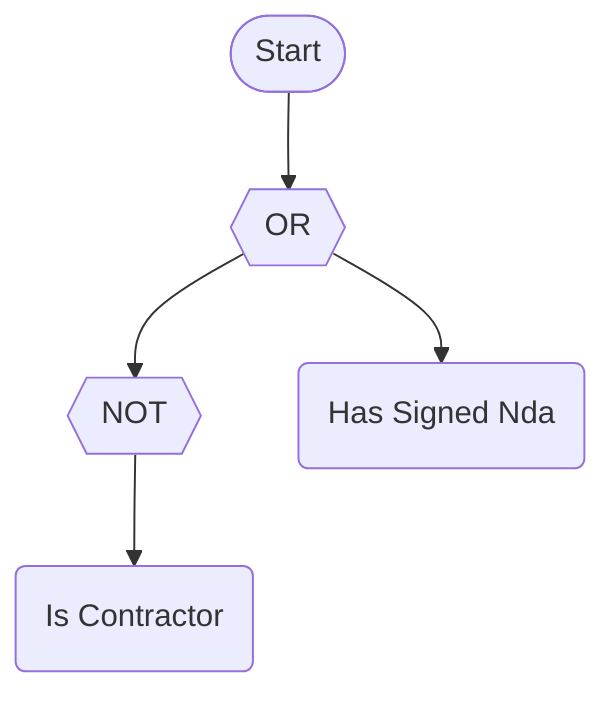

MathJax:

<!-- doctest:equation cmp latex double-dollar -->
$$\lnot \text{isContractor} \lor \text{hasSignedNda}$$

`CompressToDerived()` recognizes the shape and writes `IMPLIES`:

Word text:

<!-- doctest:ruletext cmp compress -->
```text
(isContractor IMPLIES hasSignedNda)
```

Symbolic text and Unicode:

<!-- doctest:equation cmp compress -->
```text
isContractor → hasSignedNda
```

Mermaid:

<!-- doctest:mermaid cmp shapes compress -->
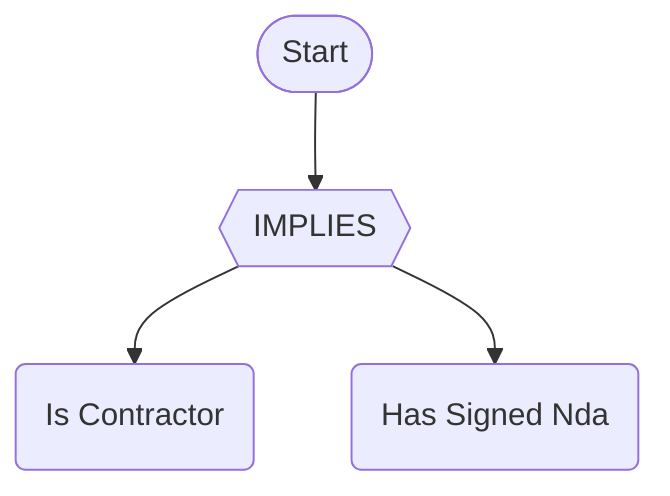

MathJax:

<!-- doctest:equation cmp compress latex double-dollar -->
$$\text{isContractor} \rightarrow \text{hasSignedNda}$$

Expanding the worked rule to primitives and then compressing it gives back the `XOR`. The [expanded form](#example-expand-to-primitives) is the starting point:

<details>
<summary>Show the four notations</summary>

Word text:

<!-- doctest:ruletext worked primitives compress -->
```text
hasTopping(topping: "greenOlives") AND (hasCrust(crust: "thin", ignoreCase: false, trim: false) OR hasCrust(crust: "stuffed", ignoreCase: true, trim: false) OR (isDineIn XOR isTakeout)) AND totalAtMost(limit: from("limits", "$.maxTotal"))
```

Symbolic text and Unicode:

<!-- doctest:equation worked primitives compress -->
```text
hasTopping(topping: "greenOlives") ∧ (hasCrust(crust: "thin", ignoreCase: false, trim: false) ∨ hasCrust(crust: "stuffed", ignoreCase: true, trim: false) ∨ (isDineIn ⊕ isTakeout)) ∧ totalAtMost(limit: from("limits", "$.maxTotal"))
```

Mermaid:

<!-- doctest:mermaid worked shapes primitives compress -->
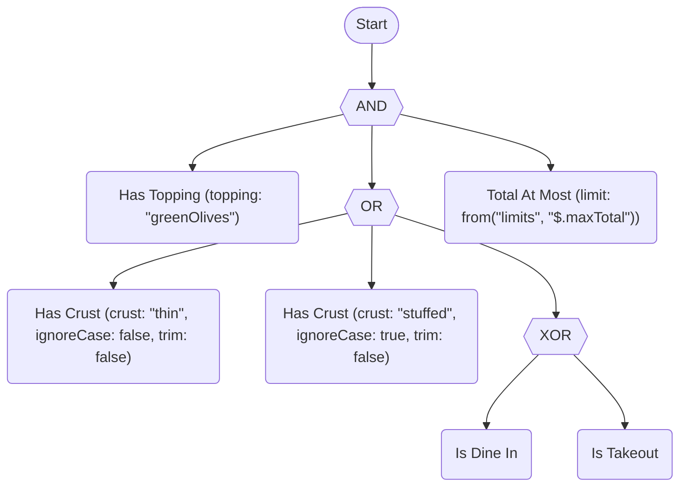

MathJax:

<!-- doctest:equation worked primitives compress latex double-dollar -->
$$\text{hasTopping(topping: "greenOlives")} \land (\text{hasCrust(crust: "thin", ignoreCase: false, trim: false)} \lor \text{hasCrust(crust: "stuffed", ignoreCase: true, trim: false)} \lor (\text{isDineIn} \oplus \text{isTakeout})) \land \text{totalAtMost(limit: from("limits", "\$.maxTotal"))}$$

</details>

### Canonical form

`Canonicalize()` gives rules that are equivalent under a fixed set of Strong Kleene-sound rewrites one deterministic representation. You can then compare, cache and de-duplicate rules by their `CanonicalText`. It is deterministic and idempotent (`Canonicalize()` of a canonical rule is the same rule). It evaluates like the original for every `True`/`False`/`Unknown` assignment, and it is never larger than the original. To find rules that are not yet canonical, switch on the `NotCanonical` lint (`TRE0030`, see [lint rules](diagnostics.md#lint-rules-opt-in)).

The rewrites, in the order they are applied (bottom-up, repeated until stable):

1. **Aliases collapse.** `ANY(...)` and `AtLeast(1, ...)` become `OR`. `ALL(...)` and `AtLeast(n, ...)` become `AND`. `GreaterThan(k)` becomes `AtLeast(k + 1)`. `LessThan(k)` becomes `AtMost(k - 1)`. `ExactlyOne(...)` becomes `Exactly(1, ...)`.
2. **Double negation.** `NOT NOT x` becomes `x` (this holds in K3).
3. **Flatten.** `AND` inside `AND`, `OR` inside `OR` and `COALESCE` inside `COALESCE` are spliced into the parent. All three are associative.
4. **Sort.** The operands of the commutative operators (`AND`, `OR`, `XOR`, `EQUIVALENT`, `NAND`, `NOR`, `PARITY`, `ExactlyOne`, the threshold family, `BETWEEN`) are sorted by their canonical text, ordinally.
5. **Deduplicate.** Repeated operands of `AND` and `OR` are removed (`a AND a` is `a`, because idempotence holds in K3). Counting operators keep repeats, because they count.

`COALESCE`, `IMPLIES` and `If` keep their operand order because it carries meaning. **Nothing is folded and no complement law is used.** `a OR NOT a` is not `True` in Strong Kleene logic (it is `Unknown` when `a` is), so it stays as a two-operand `OR`. Constant folding and the other cost-reducing rewrites belong to `Simplify()`.

> [!IMPORTANT]
> The canonical rule has the same *value* as the original but not the same *evaluation order*. Reordering, flattening and removing duplicates can change which predicate runs first, which predicates run at all once a short-circuit applies, and so which faults are reported. Use a canonical rule as a comparison or storage key. Keep evaluating the rule as written if invocation order matters.

#### Example: canonical form

The small rule has an `ANY`, a double negation and operands in no fixed order:

<!-- doctest:rule can -->
```text
isTakeout AND (ANY(isContractor, isBanned) AND NOT NOT isDineIn)
```

Word text:

<!-- doctest:ruletext can -->
```text
isTakeout AND (ANY(isContractor, isBanned) AND NOT NOT isDineIn)
```

Symbolic text and Unicode:

<!-- doctest:equation can -->
```text
isTakeout ∧ (ANY(isContractor, isBanned) ∧ ¬¬isDineIn)
```

Mermaid:

<!-- doctest:mermaid can shapes -->
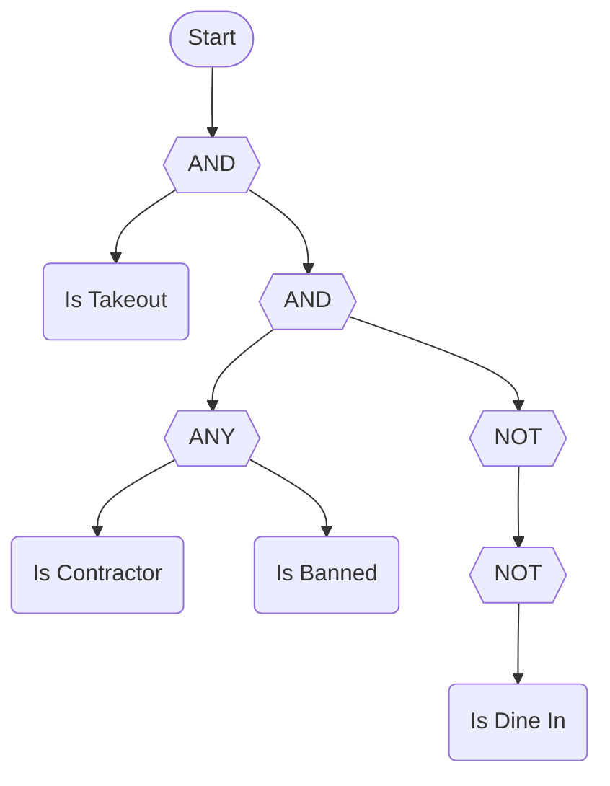

MathJax:

<!-- doctest:equation can latex double-dollar -->
$$\text{isTakeout} \land (\text{ANY}(\text{isContractor}, \text{isBanned}) \land \lnot \lnot \text{isDineIn})$$

`Canonicalize()` writes `ANY` as `OR`, removes `NOT NOT`, splices the inner `AND` into the outer one and sorts the operands by their canonical text:

Word text:

<!-- doctest:ruletext can canonicalize -->
```text
(isBanned OR isContractor) AND isDineIn AND isTakeout
```

Symbolic text and Unicode:

<!-- doctest:equation can canonicalize -->
```text
(isBanned ∨ isContractor) ∧ isDineIn ∧ isTakeout
```

Mermaid:

<!-- doctest:mermaid can shapes canonicalize -->
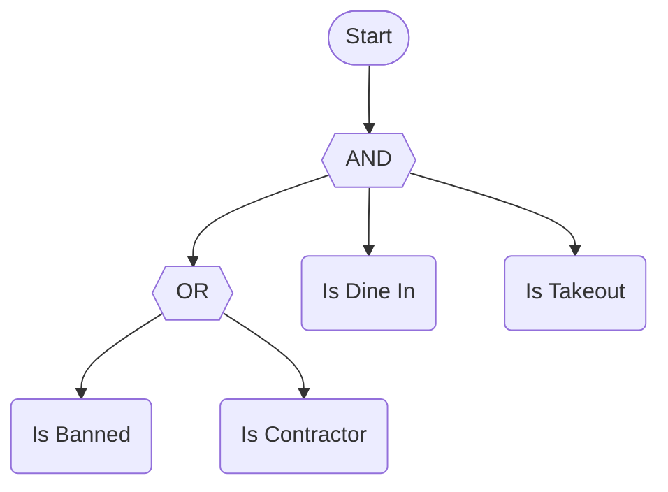

MathJax:

<!-- doctest:equation can canonicalize latex double-dollar -->
$$(\text{isBanned} \lor \text{isContractor}) \land \text{isDineIn} \land \text{isTakeout}$$

In the worked rule, the sort puts the `OR` group first, because `(` sorts before a letter. Inside the group, the `XOR` comes first and the `stuffed` term comes before the `thin` term:

<details>
<summary>Show the four notations</summary>

Word text:

<!-- doctest:ruletext worked canonicalize -->
```text
((isDineIn XOR isTakeout) OR hasCrust(crust: "stuffed", ignoreCase: true, trim: false) OR hasCrust(crust: "thin", ignoreCase: false, trim: false)) AND hasTopping(topping: "greenOlives") AND totalAtMost(limit: from("limits", "$.maxTotal"))
```

Symbolic text and Unicode:

<!-- doctest:equation worked canonicalize -->
```text
((isDineIn ⊕ isTakeout) ∨ hasCrust(crust: "stuffed", ignoreCase: true, trim: false) ∨ hasCrust(crust: "thin", ignoreCase: false, trim: false)) ∧ hasTopping(topping: "greenOlives") ∧ totalAtMost(limit: from("limits", "$.maxTotal"))
```

Mermaid:

<!-- doctest:mermaid worked shapes canonicalize -->
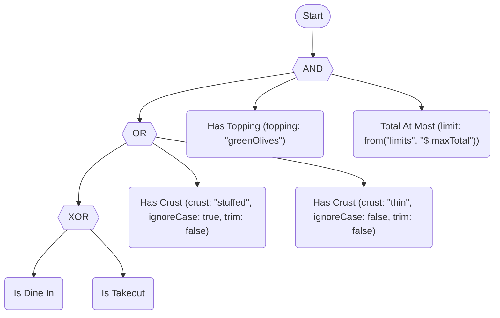

MathJax:

<!-- doctest:equation worked canonicalize latex double-dollar -->
$$((\text{isDineIn} \oplus \text{isTakeout}) \lor \text{hasCrust(crust: "stuffed", ignoreCase: true, trim: false)} \lor \text{hasCrust(crust: "thin", ignoreCase: false, trim: false)}) \land \text{hasTopping(topping: "greenOlives")} \land \text{totalAtMost(limit: from("limits", "\$.maxTotal"))}$$

</details>

### Simplify

`Simplify()` replaces a rule with an equivalent, cheaper one. It starts from the [canonical form](#canonical-form) and then applies only rewrites that are identities of Strong Kleene logic, repeating until nothing changes. The result evaluates like the original for every `True`/`False`/`Unknown` assignment, is never larger (counted in nodes), and simplifying it again changes nothing.

| Rewrite | Example |
| --- | --- |
| Identity and annihilator constants | `a AND True` is `a`; `a AND False` is `False`; `a OR False` is `a`; `a OR True` is `True` |
| `Unknown` is kept | `a AND Unknown` stays; `True AND Unknown` is `Unknown`; `NOT Unknown` is `Unknown` |
| Constant folding | `NOT True` is `False`; any operator over constants folds to a constant |
| Idempotence, double negation, flattening | `a AND a` is `a`; `NOT NOT a` is `a`; `a AND (b AND a)` is `a AND b` |
| Absorption | `a AND (a OR b)` is `a`; `a OR (a AND b)` is `a` |
| De Morgan, only where it removes nodes | `NOT (NOT a AND NOT b)` is `a OR b`; `NOT a NAND NOT b` is `a OR b` |
| Negation through derived operators | `NOT a IMPLIES b` is `a OR b`; `NOT a XOR b` is `a EQUIVALENT b`; `NOT IsKnown(a)` is `IsUnknown(a)` |
| `COALESCE` | `COALESCE(Unknown, a)` is `a`; `COALESCE(a, True, b)` is `COALESCE(a, True)`; `COALESCE(IsKnown(a), b)` is `IsKnown(a)`; `COALESCE(IsTrue(a), False)` is `IsTrue(a)` |
| Inspections | `IsKnown(True)` is `True`; `IsUnknown(IsTrue(a))` is `False`; `IsTrue(NOT a)` is `IsFalse(a)` |
| `If` | `If(True, a, b)` is `a`; `If(c, a, a)` is `a` |
| Derived operator with a constant operand | `a IMPLIES False` is `NOT a`; `a XOR True` is `NOT a`; `a NAND False` is `True` (expanded one level, simplified, kept only if no larger) |
| Thresholds with `True`/`False` operands | `AtLeast(2, True, a, b)` is `a OR b`; `AtMost(0, True, a, b)` is `False`; `Exactly(2, True, True, a)` is `NOT a` |

"Never `Unknown`" operands (constants, the inspections, a `COALESCE` with such an operand, and operators over only those) also let `COALESCE` and the inspections be removed.

**Classical rules that deliberately do not apply.** Each of these is valid in two-valued logic and false in Strong Kleene logic, because it fails when `a` is `Unknown`. `Simplify()` never uses them, so the rule keeps its value:

- Excluded middle (`a OR NOT a` is `True`) and non-contradiction (`a AND NOT a` is `False`).
- `a IMPLIES a` and `a EQUIVALENT a` as `True`, and `a XOR a` as `False`.
- Complement absorption (`a AND (NOT a OR b)` as `a AND b`, `a OR (NOT a AND b)` as `a OR b`). With `a` and `b` set to `Unknown` and `False`, `Unknown AND (Unknown OR False)` is `Unknown`, but `Unknown AND False` is `False`.
- Choosing a branch of `If(c, t, f)` when `c` is `Unknown`. It yields a value only when both branches agree.

[Laws that fail](strong-k3/specification/semantics.md#laws-that-fail) lists each law with its counter-example. Only plain absorption (`a AND (a OR b)`) holds, because `AND` and `OR` form a lattice.

> [!IMPORTANT]
> Like `Canonicalize()`, simplification keeps the *value* but not the evaluation order or side effects. Operands can be reordered, merged or dropped. An annihilated `AND` never evaluates its other operands, so a predicate that the original would have invoked (and any fault it would have reported) may not run.

The rewrite does not use the dual-rail findings of the analyzer. The analyzer reports those as diagnostics (`StructuralTautology`, `StructuralContradiction`) for authors. Every simplification here is a local, structural rule that is easy to check.

#### Example: simplify

The small rule has an identity constant, a repeated operand and an `OR` with `False`:

<!-- doctest:rule simp -->
```text
(isBanned AND True) OR (isContractor AND isContractor) OR False
```

Word text:

<!-- doctest:ruletext simp -->
```text
(isBanned AND True) OR (isContractor AND isContractor) OR False
```

Symbolic text and Unicode:

<!-- doctest:equation simp -->
```text
(isBanned ∧ True) ∨ (isContractor ∧ isContractor) ∨ False
```

Mermaid:

<!-- doctest:mermaid simp shapes -->
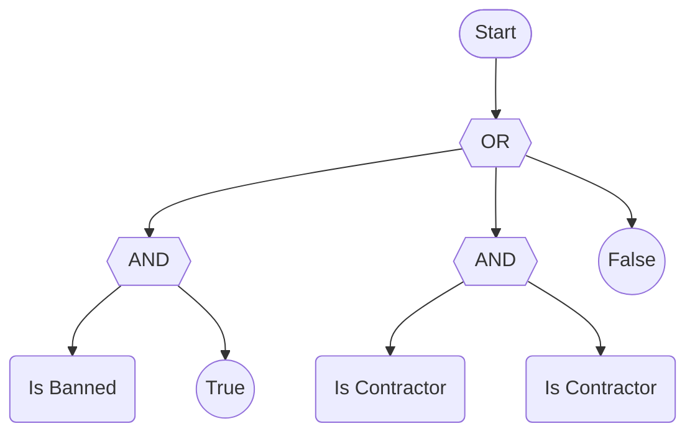

MathJax:

<!-- doctest:equation simp latex double-dollar -->
$$(\text{isBanned} \land \text{True}) \lor (\text{isContractor} \land \text{isContractor}) \lor \text{False}$$

`Simplify()` removes the `True`, the repeat and the `False`:

Word text:

<!-- doctest:ruletext simp simplify -->
```text
isBanned OR isContractor
```

Symbolic text and Unicode:

<!-- doctest:equation simp simplify -->
```text
isBanned ∨ isContractor
```

Mermaid:

<!-- doctest:mermaid simp shapes simplify -->
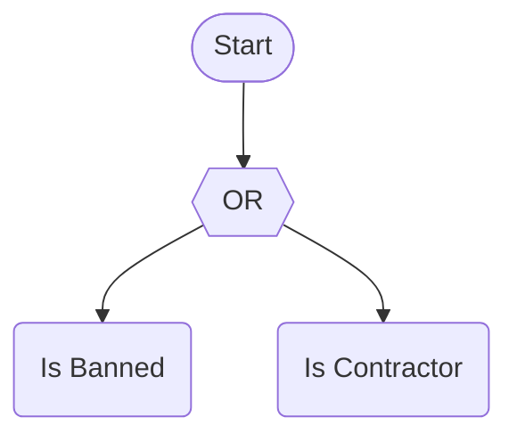

MathJax:

<!-- doctest:equation simp simplify latex double-dollar -->
$$\text{isBanned} \lor \text{isContractor}$$

The worked rule has nothing to remove. `Simplify()` returns its canonical form, the same rule that `Canonicalize()` returns:

<details>
<summary>Show the four notations</summary>

Word text:

<!-- doctest:ruletext worked simplify -->
```text
((isDineIn XOR isTakeout) OR hasCrust(crust: "stuffed", ignoreCase: true, trim: false) OR hasCrust(crust: "thin", ignoreCase: false, trim: false)) AND hasTopping(topping: "greenOlives") AND totalAtMost(limit: from("limits", "$.maxTotal"))
```

Symbolic text and Unicode:

<!-- doctest:equation worked simplify -->
```text
((isDineIn ⊕ isTakeout) ∨ hasCrust(crust: "stuffed", ignoreCase: true, trim: false) ∨ hasCrust(crust: "thin", ignoreCase: false, trim: false)) ∧ hasTopping(topping: "greenOlives") ∧ totalAtMost(limit: from("limits", "$.maxTotal"))
```

Mermaid:

<!-- doctest:mermaid worked shapes simplify -->


MathJax:

<!-- doctest:equation worked simplify latex double-dollar -->
$$((\text{isDineIn} \oplus \text{isTakeout}) \lor \text{hasCrust(crust: "stuffed", ignoreCase: true, trim: false)} \lor \text{hasCrust(crust: "thin", ignoreCase: false, trim: false)}) \land \text{hasTopping(topping: "greenOlives")} \land \text{totalAtMost(limit: from("limits", "\$.maxTotal"))}$$

</details>

### See which laws Simplify applied

`SimplifyWithSteps()` does the same work as `Simplify()` and also lists each change. It returns a `SimplifyResult<TContext>` with the simplified `Rule` and a list of `Steps`.

```csharp
CompiledRule<MyContext> rule = compiler.Compile("(a AND True) AND (a OR b)").GetRuleOrThrow();
SimplifyResult<MyContext> result = rule.SimplifyWithSteps();

foreach (RewriteStep step in result.Steps)
{
    Console.WriteLine($"{step.Law}: {step.Before} => {step.After}");
}

// result.Rule has the same canonical text as rule.Simplify().GetRuleOrThrow().
```

Each `RewriteStep` has three members:

| Member | Meaning |
| --- | --- |
| `Law` | A `RewriteLaw`: `AliasCollapse`, `DoubleNegation`, `Flatten`, `Reorder`, `Idempotence`, `ConstantFold`, `Identity`, `Annihilator`, `Absorption`, `DeMorgan`, `NegationThroughDerived`, `Coalesce`, `Inspection`, `If`, `DerivedWithConstant` or `Threshold`. |
| `Before` | The canonical text of the changed subtree before the step. |
| `After` | The canonical text of the changed subtree after the step. |

- **Order.** The steps are in the order the rewrite applied them. The canonical-form laws come first: aliases, double negation, flattening, ordering and repeated operands. The simplification laws follow. The canonical-form laws run again between passes.
- **Subtree text.** A step shows the subtree as it stood when the rewrite reached it. An earlier step can already have changed its operands, so `Before` is not always a substring of the original rule text.
- **Reorder.** Sorting the operands of a commutative operator is a step. The value does not change, but the text does.
- **One step for an expansion.** A derived operator with a constant operand (`a XOR True`) is one `DerivedWithConstant` step. The expansion inside it is not listed.
- **Already simple.** A rule that `Simplify()` leaves as written returns an empty list.

**Relation to `RuleDiff`.** `RuleDiff.Compare(before, after)` compares two finished rules. It reports what differs and whether the meaning is preserved. It does not report why the rules differ. The step list reports why: each step names a law. To show a rewrite, print the steps. For the net difference, call `RuleDiff.Compare(rule, result.Rule)`. The diff and the step list always agree on whether the rule changed.

### Normal forms

`ToNnf()`, `ToCnf()` and `ToDnf()` rewrite a rule into negation, conjunctive or disjunctive normal form. Each returns a `CompilationResult<TContext>` like the other size-capped rewrites, and each result has the same value as the original for every `True`/`False`/`Unknown` assignment.

```csharp
CompiledRule<MyContext> rule = compiler.Compile("NOT (a AND (b OR c))").GetRuleOrThrow();

Console.WriteLine(rule.ToNnf().GetRuleOrThrow().CanonicalText);   // NOT a OR (NOT b AND NOT c)
Console.WriteLine(rule.ToDnf().GetRuleOrThrow().CanonicalText);   // NOT a OR (NOT b AND NOT c)
Console.WriteLine(rule.ToCnf().GetRuleOrThrow().CanonicalText);   // (NOT a OR NOT b) AND (NOT a OR NOT c)
```

| Form | Shape | How |
| --- | --- | --- |
| NNF | `NOT` only directly above a term or an atom | Strong Kleene De Morgan laws and double negation. Derived operators expand first. |
| CNF | An `AND` of `OR`s of literals and atoms | NNF, then `OR` is distributed over `AND`. |
| DNF | An `OR` of `AND`s of literals and atoms | NNF, then `AND` is distributed over `OR`. |

A literal is a term or the `NOT` of a term. The Strong Kleene connectives form a distributive lattice with De Morgan negation, so distribution is an identity. No classical complement law is used: `a AND NOT a` and `a OR NOT a` stay as written. A repeated literal in a clause and a repeated clause are dropped, because idempotence holds. Each form is idempotent: rewriting a rewritten rule changes nothing.

- **Atoms.** `COALESCE`, the inspections (`IsTrue`, `IsFalse`, `IsUnknown`, `IsKnown`) and `If` are not information-monotone. Each is an atom: no `NOT` is pushed into it. The operands inside it are normalized.
- **Size.** A normal form can be larger than the rule. CNF and DNF can grow exponentially. Each form is capped by `CompilerOptions.MaxRewriteNodeCount` (see [Size cap](#size-cap)). A larger result is not built: `CompiledRule` is `null` and one `TRE0016` error is returned.
- **Value, not order.** Distribution and de-duplication can change which predicates run and which faults appear. The value never changes.

#### Thresholds and `ExpandThresholds`

A threshold (`AtLeast`, `AtMost`, `Exactly`, `GreaterThan` and `LessThan`) has one group for every subset of its operands. The cardinality operators that expand to thresholds (`PARITY`, `BETWEEN` and `ExactlyOne`) follow the same rule. The expansion has `C(n, k)` groups, so it is opt-in. Pass a `NormalFormOptions` value:

```csharp
CompiledRule<MyContext> rule = compiler.Compile("a AND AtLeast(2, b, c, d, e)").GetRuleOrThrow();

// Default: the threshold stays an atom and the result carries a TRE0031 warning.
CompilationResult<MyContext> kept = rule.ToDnf();
Console.WriteLine(kept.Diagnostics[0].Message);   // ToDnf kept AtLeast(2, b, c, d, e) as an atom. Expanding it would add about 19 nodes.

// Opt in: the threshold expands to AND/OR, within the node cap.
CompilationResult<MyContext> expanded = rule.ToDnf(new NormalFormOptions(ExpandThresholds: true));
```

| `ExpandThresholds` | Result |
| --- | --- |
| `false` (default) | A threshold stays an atom. Its operands are normalized. One `TRE0031` warning per distinct threshold gives the growth estimate in nodes. A `NOT` above it stays above it. |
| `true` | A threshold expands to `AND`, `OR` and `NOT` over its operands. A result over `MaxRewriteNodeCount` returns `TRE0016` and no rule. |

A threshold that is only an `OR` or an `AND` (`AtLeast(1, ...)`, `AtLeast(n, ...)`, `AtMost(0, ...)` or `AtMost(n - 1, ...)`) always expands, with no warning. So do `ANY`, `ALL` and `NONE`. The warning code is in [Diagnostics](strong-k3/specification/diagnostics.md).

#### Example: the three forms

The small rule has a `NOT` above an `AND` that holds an `OR`:

<!-- doctest:rule nf -->
```text
NOT (approvedByAlice AND (approvedByBob OR approvedByCarol))
```

Word text:

<!-- doctest:ruletext nf -->
```text
NOT (approvedByAlice AND (approvedByBob OR approvedByCarol))
```

Symbolic text and Unicode:

<!-- doctest:equation nf -->
```text
¬(approvedByAlice ∧ (approvedByBob ∨ approvedByCarol))
```

Mermaid:

<!-- doctest:mermaid nf shapes -->
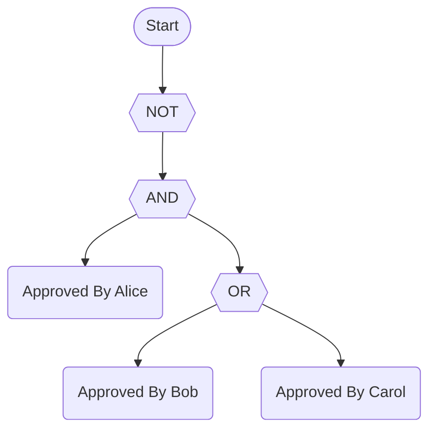

MathJax:

<!-- doctest:equation nf latex double-dollar -->
$$\lnot (\text{approvedByAlice} \land (\text{approvedByBob} \lor \text{approvedByCarol}))$$

##### Negation normal form

`ToNnf()` moves each `NOT` down to a term. De Morgan's laws turn `NOT (a AND b)` into `NOT a OR NOT b`. A derived operator expands first, so the `XOR` of the worked rule becomes two `AND` groups under an `OR`.

Word text:

<!-- doctest:ruletext nf nnf -->
```text
NOT approvedByAlice OR (NOT approvedByBob AND NOT approvedByCarol)
```

Symbolic text and Unicode:

<!-- doctest:equation nf nnf -->
```text
¬approvedByAlice ∨ (¬approvedByBob ∧ ¬approvedByCarol)
```

Mermaid:

<!-- doctest:mermaid nf shapes nnf -->


MathJax:

<!-- doctest:equation nf nnf latex double-dollar -->
$$\lnot \text{approvedByAlice} \lor (\lnot \text{approvedByBob} \land \lnot \text{approvedByCarol})$$

The worked rule:

<details>
<summary>Show the four notations</summary>

Word text:

<!-- doctest:ruletext worked nnf -->
```text
hasTopping(topping: "greenOlives") AND (hasCrust(crust: "thin", ignoreCase: false, trim: false) OR hasCrust(crust: "stuffed", ignoreCase: true, trim: false) OR ((isDineIn AND NOT isTakeout) OR (NOT isDineIn AND isTakeout))) AND totalAtMost(limit: from("limits", "$.maxTotal"))
```

Symbolic text and Unicode:

<!-- doctest:equation worked nnf -->
```text
hasTopping(topping: "greenOlives") ∧ (hasCrust(crust: "thin", ignoreCase: false, trim: false) ∨ hasCrust(crust: "stuffed", ignoreCase: true, trim: false) ∨ ((isDineIn ∧ ¬isTakeout) ∨ (¬isDineIn ∧ isTakeout))) ∧ totalAtMost(limit: from("limits", "$.maxTotal"))
```

Mermaid:

<!-- doctest:mermaid worked shapes nnf -->
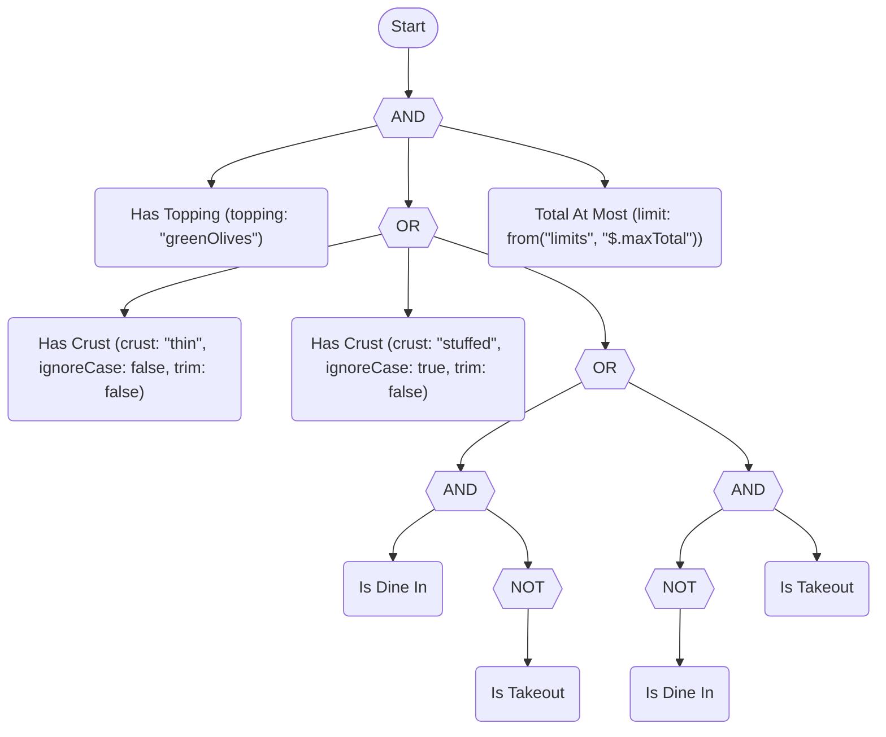

MathJax:

<!-- doctest:equation worked nnf latex double-dollar -->
$$\text{hasTopping(topping: "greenOlives")} \land (\text{hasCrust(crust: "thin", ignoreCase: false, trim: false)} \lor \text{hasCrust(crust: "stuffed", ignoreCase: true, trim: false)} \lor ((\text{isDineIn} \land \lnot \text{isTakeout}) \lor (\lnot \text{isDineIn} \land \text{isTakeout}))) \land \text{totalAtMost(limit: from("limits", "\$.maxTotal"))}$$

</details>

##### Conjunctive normal form

`ToCnf()` writes the rule as an `AND` of clauses, and each clause is an `OR` of literals. The small rule gets two clauses.

Word text:

<!-- doctest:ruletext nf cnf -->
```text
(NOT approvedByAlice OR NOT approvedByBob) AND (NOT approvedByAlice OR NOT approvedByCarol)
```

Symbolic text and Unicode:

<!-- doctest:equation nf cnf -->
```text
(¬approvedByAlice ∨ ¬approvedByBob) ∧ (¬approvedByAlice ∨ ¬approvedByCarol)
```

Mermaid:

<!-- doctest:mermaid nf shapes cnf -->
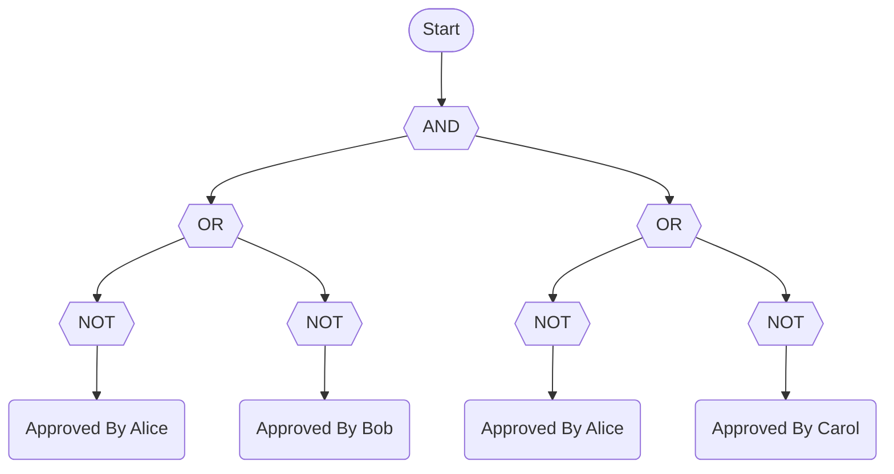

MathJax:

<!-- doctest:equation nf cnf latex double-dollar -->
$$(\lnot \text{approvedByAlice} \lor \lnot \text{approvedByBob}) \land (\lnot \text{approvedByAlice} \lor \lnot \text{approvedByCarol})$$

The worked rule gets six clauses. The `XOR` alone gives four of them, two of which are `isDineIn OR NOT isDineIn` and `NOT isTakeout OR isTakeout`. [Strong K3 differences](#strong-k3-differences) explains why they stay.

<details>
<summary>Show the four notations</summary>

Word text:

<!-- doctest:ruletext worked cnf -->
```text
hasTopping(topping: "greenOlives") AND (hasCrust(crust: "thin", ignoreCase: false, trim: false) OR hasCrust(crust: "stuffed", ignoreCase: true, trim: false) OR isDineIn OR NOT isDineIn) AND (hasCrust(crust: "thin", ignoreCase: false, trim: false) OR hasCrust(crust: "stuffed", ignoreCase: true, trim: false) OR isDineIn OR isTakeout) AND (hasCrust(crust: "thin", ignoreCase: false, trim: false) OR hasCrust(crust: "stuffed", ignoreCase: true, trim: false) OR NOT isTakeout OR NOT isDineIn) AND (hasCrust(crust: "thin", ignoreCase: false, trim: false) OR hasCrust(crust: "stuffed", ignoreCase: true, trim: false) OR NOT isTakeout OR isTakeout) AND totalAtMost(limit: from("limits", "$.maxTotal"))
```

Symbolic text and Unicode:

<!-- doctest:equation worked cnf -->
```text
hasTopping(topping: "greenOlives") ∧ (hasCrust(crust: "thin", ignoreCase: false, trim: false) ∨ hasCrust(crust: "stuffed", ignoreCase: true, trim: false) ∨ isDineIn ∨ ¬isDineIn) ∧ (hasCrust(crust: "thin", ignoreCase: false, trim: false) ∨ hasCrust(crust: "stuffed", ignoreCase: true, trim: false) ∨ isDineIn ∨ isTakeout) ∧ (hasCrust(crust: "thin", ignoreCase: false, trim: false) ∨ hasCrust(crust: "stuffed", ignoreCase: true, trim: false) ∨ ¬isTakeout ∨ ¬isDineIn) ∧ (hasCrust(crust: "thin", ignoreCase: false, trim: false) ∨ hasCrust(crust: "stuffed", ignoreCase: true, trim: false) ∨ ¬isTakeout ∨ isTakeout) ∧ totalAtMost(limit: from("limits", "$.maxTotal"))
```

Mermaid:

<!-- doctest:mermaid worked shapes cnf -->
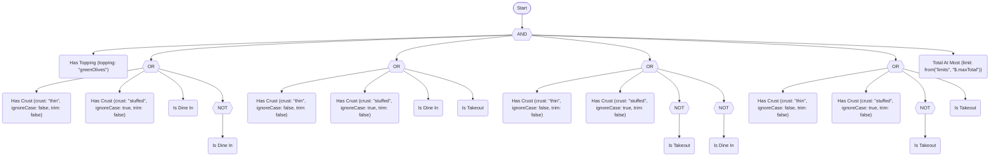

MathJax:

<!-- doctest:equation worked cnf latex double-dollar -->
$$\text{hasTopping(topping: "greenOlives")} \land (\text{hasCrust(crust: "thin", ignoreCase: false, trim: false)} \lor \text{hasCrust(crust: "stuffed", ignoreCase: true, trim: false)} \lor \text{isDineIn} \lor \lnot \text{isDineIn}) \land (\text{hasCrust(crust: "thin", ignoreCase: false, trim: false)} \lor \text{hasCrust(crust: "stuffed", ignoreCase: true, trim: false)} \lor \text{isDineIn} \lor \text{isTakeout}) \land (\text{hasCrust(crust: "thin", ignoreCase: false, trim: false)} \lor \text{hasCrust(crust: "stuffed", ignoreCase: true, trim: false)} \lor \lnot \text{isTakeout} \lor \lnot \text{isDineIn}) \land (\text{hasCrust(crust: "thin", ignoreCase: false, trim: false)} \lor \text{hasCrust(crust: "stuffed", ignoreCase: true, trim: false)} \lor \lnot \text{isTakeout} \lor \text{isTakeout}) \land \text{totalAtMost(limit: from("limits", "\$.maxTotal"))}$$

</details>

##### Disjunctive normal form

`ToDnf()` writes the rule as an `OR` of groups, and each group is an `AND` of literals. The small rule is already in this shape after NNF, so DNF equals NNF.

Word text:

<!-- doctest:ruletext nf dnf -->
```text
NOT approvedByAlice OR (NOT approvedByBob AND NOT approvedByCarol)
```

Symbolic text and Unicode:

<!-- doctest:equation nf dnf -->
```text
¬approvedByAlice ∨ (¬approvedByBob ∧ ¬approvedByCarol)
```

Mermaid:

<!-- doctest:mermaid nf shapes dnf -->
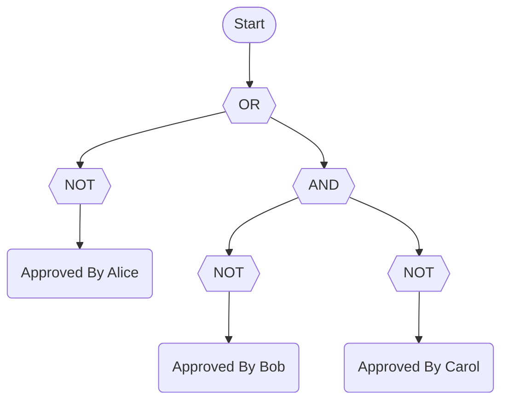

MathJax:

<!-- doctest:equation nf dnf latex double-dollar -->
$$\lnot \text{approvedByAlice} \lor (\lnot \text{approvedByBob} \land \lnot \text{approvedByCarol})$$

The worked rule gets four groups, one for each way to satisfy the middle `OR`. Each group repeats `hasTopping` and `totalAtMost`.

<details>
<summary>Show the four notations</summary>

Word text:

<!-- doctest:ruletext worked dnf -->
```text
(hasTopping(topping: "greenOlives") AND hasCrust(crust: "thin", ignoreCase: false, trim: false) AND totalAtMost(limit: from("limits", "$.maxTotal"))) OR (hasTopping(topping: "greenOlives") AND hasCrust(crust: "stuffed", ignoreCase: true, trim: false) AND totalAtMost(limit: from("limits", "$.maxTotal"))) OR (hasTopping(topping: "greenOlives") AND isDineIn AND NOT isTakeout AND totalAtMost(limit: from("limits", "$.maxTotal"))) OR (hasTopping(topping: "greenOlives") AND NOT isDineIn AND isTakeout AND totalAtMost(limit: from("limits", "$.maxTotal")))
```

Symbolic text and Unicode:

<!-- doctest:equation worked dnf -->
```text
(hasTopping(topping: "greenOlives") ∧ hasCrust(crust: "thin", ignoreCase: false, trim: false) ∧ totalAtMost(limit: from("limits", "$.maxTotal"))) ∨ (hasTopping(topping: "greenOlives") ∧ hasCrust(crust: "stuffed", ignoreCase: true, trim: false) ∧ totalAtMost(limit: from("limits", "$.maxTotal"))) ∨ (hasTopping(topping: "greenOlives") ∧ isDineIn ∧ ¬isTakeout ∧ totalAtMost(limit: from("limits", "$.maxTotal"))) ∨ (hasTopping(topping: "greenOlives") ∧ ¬isDineIn ∧ isTakeout ∧ totalAtMost(limit: from("limits", "$.maxTotal")))
```

Mermaid:

<!-- doctest:mermaid worked shapes dnf -->
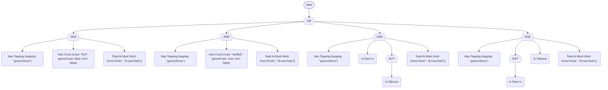

MathJax:

<!-- doctest:equation worked dnf latex double-dollar -->
$$(\text{hasTopping(topping: "greenOlives")} \land \text{hasCrust(crust: "thin", ignoreCase: false, trim: false)} \land \text{totalAtMost(limit: from("limits", "\$.maxTotal"))}) \lor (\text{hasTopping(topping: "greenOlives")} \land \text{hasCrust(crust: "stuffed", ignoreCase: true, trim: false)} \land \text{totalAtMost(limit: from("limits", "\$.maxTotal"))}) \lor (\text{hasTopping(topping: "greenOlives")} \land \text{isDineIn} \land \lnot \text{isTakeout} \land \text{totalAtMost(limit: from("limits", "\$.maxTotal"))}) \lor (\text{hasTopping(topping: "greenOlives")} \land \lnot \text{isDineIn} \land \text{isTakeout} \land \text{totalAtMost(limit: from("limits", "\$.maxTotal"))})$$

</details>

#### Size of each form

`RuleMetrics.Depth` is the number of nodes on the longest path from the root to a leaf. `RuleMetrics.NodeCount` counts the tree, so a term that appears twice counts twice. The numbers come from the rules above:

<!-- doctest:metrics nf nnf cnf dnf -->
| Form | Depth | NodeCount |
| --- | --- | --- |
| Original | 4 | 6 |
| NNF | 4 | 8 |
| CNF | 4 | 11 |
| DNF | 4 | 8 |

<!-- doctest:metrics worked nnf cnf dnf -->
| Form | Depth | NodeCount |
| --- | --- | --- |
| Original | 4 | 9 |
| NNF | 6 | 15 |
| CNF | 4 | 27 |
| DNF | 4 | 21 |

#### A rule that grows sharply

CNF and DNF distribute one operator over another. A rule that is an `OR` of `n` pairs is already in DNF, and its CNF has `2^n` clauses, because a clause takes one operand from each pair:

<!-- doctest:rule pairs -->
```text
(isDineIn AND isTakeout) OR (isBanned AND isContractor) OR (hasSignedNda AND lovesPineapple) OR (approvedByAlice AND approvedByBob) OR (approvedByCarol AND isPrimaryReviewer)
```

<!-- doctest:metrics pairs dnf cnf -->
| Form | Depth | NodeCount |
| --- | --- | --- |
| Original | 3 | 16 |
| DNF | 3 | 16 |
| CNF | 3 | 193 |

Five pairs give 32 clauses of five literals each. Each added pair doubles the clause count. The default `MaxRewriteNodeCount` is 100,000, so this rule fits. To see a refusal, pass a smaller cap for one call as the `maxNodeCount` argument. A cap of 100 nodes refuses the CNF:

```csharp
CompilationResult<MyContext> cnf = rule.ToCnf(maxNodeCount: 100);
Console.WriteLine(cnf.FormatDiagnostics());
```

<!-- doctest:rewrite-diagnostics pairs cnf cap=100 -->
```text
TRE0016 error: ToCnf would produce more than the maximum of 100 nodes.
  Expected: at most 100 nodes
  Found: more nodes than that
  Hint: Raise the maxNodeCount argument or CompilerOptions.MaxRewriteNodeCount, or simplify the rule first.
```

`CompiledRule` is `null` and `Succeeded` is `false`. The same rule in DNF keeps its size, so `ToDnf(maxNodeCount: 100)` succeeds. The mirror rule, an `AND` of `n` pairs of `OR`s, is already in CNF, and its DNF has `2^n` groups.

#### Strong K3 differences

Strong Kleene logic has three values. Two classical laws that a normal form often uses do not hold, and the rewrites never use them:

- **Excluded middle.** `a OR NOT a` is `True` in two-valued logic. In Strong K3 it is `Unknown` when `a` is `Unknown`.
- **Non-contradiction.** `a AND NOT a` is `False` in two-valued logic. In Strong K3 it is `Unknown` when `a` is `Unknown`.

| `a` | `NOT a` | `a OR NOT a` | `a AND NOT a` |
| --- | --- | --- | --- |
| `True` | `False` | `True` | `False` |
| `False` | `True` | `True` | `False` |
| `Unknown` | `Unknown` | `Unknown` | `Unknown` |

A classical CNF drops a clause such as `isDineIn OR NOT isDineIn`, because the clause is always true. In Strong K3 the clause is `Unknown` when `isDineIn` is `Unknown`, and so it changes the value of the `AND` it belongs to. The normal forms keep the clause:

<!-- doctest:rule excl -->
```text
isDineIn OR NOT isDineIn
```

<!-- doctest:ruletext excl cnf -->
```text
isDineIn OR NOT isDineIn
```

Four more points follow from the same logic:

- **Distribution is exact.** `AND` and `OR` form a distributive lattice, so CNF and DNF have the same value as the rule for all three values of every term.
- **Idempotence holds.** A repeated literal in a clause and a repeated clause are dropped.
- **Atoms stay whole.** `COALESCE`, the inspections and `If` are not information-monotone, so a `NOT` is not pushed into them. The operands inside them are normalized.
- **Value only.** A normal form has the same value as the rule. It can run the predicates in a different order and report different faults.

In this example, the `NOT` of the `AND` splits, and each `NOT` stays directly above its operand. The `NOT` does not enter `IsTrue(isDineIn)`:

<!-- doctest:rule atom -->
```text
NOT (IsTrue(isDineIn) AND isTakeout)
```

<!-- doctest:ruletext atom nnf -->
```text
NOT IsTrue(isDineIn) OR NOT isTakeout
```

## Rule equivalence

`RuleEquivalence.Compare(first, second)` answers the question "do these two rules always give the same result?" under Strong Kleene logic. It uses the same dual-rail BDD as the analyzer. The check is exact, not sampled, and it returns a `RuleEquivalenceResult`:

| `Outcome` | Meaning |
| --- | --- |
| `Equivalent` | Same value for every `True`/`False`/`Unknown` assignment of the terms. |
| `NotEquivalent` | Some assignment differs. `CounterExample` maps every distinct term in either rule (keyed by its printed form, such as `hasRole(role: "Y")`) to the value it takes. |
| `Undecided` | The rules have more distinct terms between them than `CompilerOptions.MaxAnalysisTerms` (default 20). `Reason` says so. Nothing is guessed. |

```csharp
RuleEquivalenceResult result = RuleEquivalence.Compare(
    compiler.Compile("NOT (a AND b)").GetRuleOrThrow(),
    compiler.Compile("NOT a OR NOT b").GetRuleOrThrow());
// result.Outcome == RuleEquivalenceOutcome.Equivalent

RuleEquivalenceResult excluded = RuleEquivalence.Compare(
    compiler.Compile("a OR NOT a").GetRuleOrThrow(),
    compiler.Compile("TRUE").GetRuleOrThrow());
// excluded.Outcome == NotEquivalent, excluded.CounterExample["a"] == TruthValue.Unknown
```

Limits to know:

- **Terms are opaque and independent.** Two terms are the same variable only when their predicate name and arguments match. The check cannot know that two different predicates are related, so `isManager` and `isDepartmentHead` are treated as unrelated.
- **The cap is on distinct terms across both rules**, not on size. A rule pair at exactly the cap is decided. Pass the `maxAnalysisTerms` argument to change it.
- **Value only.** The check does not compare evaluation order, short-circuiting or faults.
- **A counter-example is one witness**, not all of them. Terms that the difference does not depend on are reported as `False`.
- **Strong K3 is not two-valued logic.** `a OR NOT a` is not equivalent to `TRUE`, because it is `Unknown` when `a` is.

`RuleDiff.Compare` uses this check. `RuleDiffResult.PreservesMeaning` is `true` when the rules are equivalent (including when they are structurally identical), `false` when they are not, and `null` when the term cap makes the question undecidable (default 20). To use a larger cap, call `RuleEquivalence.Compare` directly, or pass the term cap as the optional third argument of `RuleDiff.Compare(before, after, maxAnalysisTerms)`.
