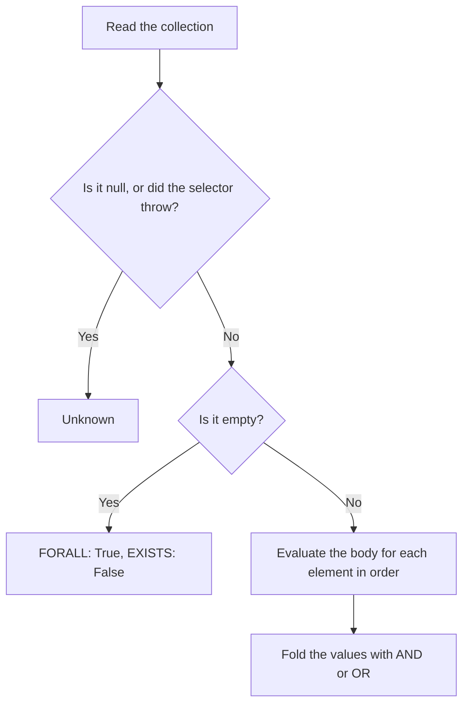

# Quantifiers

Operations that apply a rule body to every element of a collection. `FORALL` is the generalized `AND` and `EXISTS` is the generalized `OR`. Back to the [reference](../README.md).

| Operation | Kind | Summary |
| --- | --- | --- |
| [FORALL](forall.md) | Quantifier | The body is true for every element; `AND` folded over the elements |
| [EXISTS](exists.md) | Quantifier | The body is true for at least one element; `OR` folded over the elements |

## What a quantifier is

A quantifier is a third kind of Operation, next to the primitive and derived Operations. It is a Strong Kleene connective, so it is monotone in the [information order](../specification/values.md#information-order). It does not reduce to a fixed formula in the primitives, because the operand count is the size of the collection, and that size is known only when the rule is evaluated. For that reason the quantifiers are not in the [inventory of Operations](../specification/operations.md), and they have no canonical form.

A quantifier has a head and a body: `FORALL(line IN lines, body)`.

| Part | Meaning |
| --- | --- |
| `line` | The bound variable. It labels the trace (`line[2]`) and is part of tree equality and canonical text. |
| `lines` | The name of a collection binding that the host registered. Collection names are a namespace of their own, separate from predicate names and data source names. |
| `body` | A full expression, checked against the element predicates of that collection, not against the outer predicates. |

## How a quantifier decides

Let the body give the values `v1` to `vn`, one for each element, in the order that the collection selector returns them. `FORALL` is `AND(v1, ..., vn)` and `EXISTS` is `OR(v1, ..., vn)`. The special cases are:

| Collection | `FORALL` | `EXISTS` | Fault |
| --- | --- | --- | --- |
| Empty | `True` | `False` | No. These are the identity elements of `AND` and `OR`. |
| `null` | `Unknown` | `Unknown` | No. The collection is not known. |
| The selector throws | `Unknown` | `Unknown` | One fault for the collection. |
| More body runs than `EvaluationOptions.MaxElementEvaluations` allows | `Unknown` | `Unknown` | One fault, and the evaluation aborts. |

Because a `null` collection is `Unknown`, `FORALL(x IN c, True)` is not the constant `True`. No rewrite folds a quantifier to a constant.

## Evaluation

- Elements run in selector order. The selector runs at most once for each evaluation, and its result is kept as a list.
- In `ShortCircuit` mode, `FORALL` stops at the first `False` element and `EXISTS` at the first `True` element. The elements that do not run are recorded as `NotEvaluated`. In `Exhaustive` mode every element runs. The mode never changes the result.
- A term that is repeated inside one element is one call. The same term in two elements is two calls, because the element is different.
- The fault budget is one budget for the whole evaluation. A fault inside a body carries the element it came from in `Fault.Scope`, for example `lines[2]`, or `lines[2]/details[0]` for a nested quantifier. `Scope` is `null` for a fault outside any quantifier.
- A quantifier node in the trace has one child for each element, not one for each written operand. Each child is labelled `variable[index]` and holds the trace of the body for that element. An empty collection has no children.
- Quantifiers can nest, up to `CompilerOptions.MaxQuantifierDepth` (default 2). A nested quantifier cannot reuse the variable name of an enclosing one. `MaxElementEvaluations` (default 10,000) counts every body run in all quantifiers, so nested quantifiers multiply.

## Reading the element

A body reads the element in two ways, and can mix both in one body. A typed element predicate, such as `inStock`, is registered on the collection. An untyped read, `from(line, "$.qty")`, treats the element as a data source of its own. The second way works only when the host registered the collection with an element source. Without one, the read is the undeclared data source diagnostic `TRE0024`.

## Analysis and rewrites

The analyzer, `RuleEquivalence`, `RuleImplication` and `RuleOverlap` treat a quantifier as one opaque atom. The atom is keyed by its canonical text, which includes the body. Two quantifiers with the same text are the same atom. Two quantifiers with equivalent bodies that are written differently are different atoms. The results stay correct, but they can be incomplete across such rewordings.

The body is analyzed on its own, in its own scope, so a tautology or a contradiction inside a body is still reported. `ToNnf()` pushes a negation through a quantifier: `NOT FORALL(x IN c, b)` becomes `EXISTS(x IN c, NOT b)`, and the dual. Every other rewrite changes only the body.

## Diagnostics

| Code | Name | Cause |
| --- | --- | --- |
| `TRE0042` | `UnknownCollection` | The head names a collection that is not registered. |
| `TRE0043` | `MaxQuantifierDepthExceeded` | The quantifiers nest deeper than `MaxQuantifierDepth`. |
| `TRE0044` | `ShadowedVariable` | A nested quantifier reuses the variable name of an enclosing quantifier. |

The [diagnostic code catalog](../specification/diagnostics.md) has the full entries.
