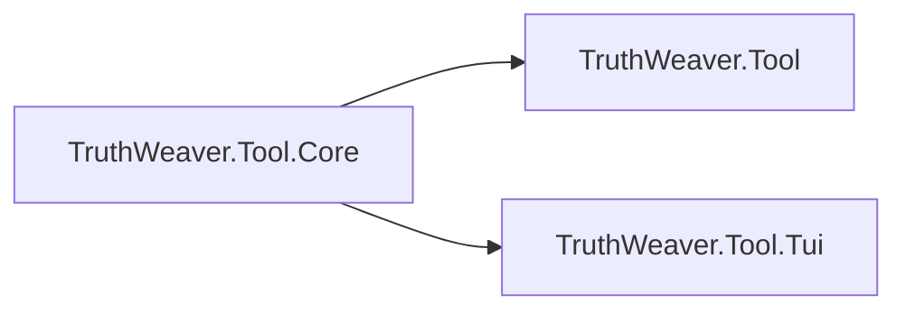

# TruthWeaver.Tool.Core

The UI-free logic that the `truthweaver` command line and the `truthweaver-tui` workbench share.

## Purpose

This project loads, detects, extracts and converts rules. It reads the `truthweaver.json` configuration, loads stub values
and data files, validates a rule on every level, makes the export artifacts and writes deterministic output. It has no
terminal code, so both front ends call the same methods and give the same results. The reference is in
[Tool core](../../docs/tool-core.md).

The project is not packable. It ships inside the two tool packages.

<!-- doctest:skip project diagram, not a rule -->

## Depends on

- [TruthWeaver.Abstractions](../TruthWeaver.Abstractions/README.md) for `TruthValue` and `Decision`.
- [TruthWeaver](../TruthWeaver/README.md) to compile, print, rewrite and evaluate the rules.
- [TruthWeaver.DataSources.Json](../TruthWeaver.DataSources.Json/README.md) to read JSON data files for `from(...)` references.
- [TruthWeaver.Yaml](../TruthWeaver.Yaml/README.md) to read and write YAML rules and data files.

## Key types

| Type | Role |
| --- | --- |
| `RuleLoader` | Loads a rule from a file or from standard input. |
| `FormatDetector` | Detects whether text is rule text, JSON or YAML. |
| `RuleConverter` | Converts a rule between the three formats. |
| `RuleValidator` | Validates a rule on every level. |
| `ArtifactCatalog` | Lists the artifacts that a rule can print or export. |
| `ArtifactExporter` | Writes one artifact, or every artifact with a manifest. |
| `ToolConfiguration` | Reads the `truthweaver.json` settings. |
| `StubEvaluator` | Evaluates a rule with stub values and data files. |
| `RuleDocument` | Holds the text, the compiled rule, the diagnostics and the undo history of an open rule. |
| `AssignmentSession` | Holds the term values, the variables and the policy for `Unknown`. |
