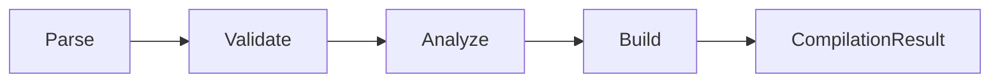

# TruthWeaver

A Strong Kleene (K3) rule engine for .NET: write a rule once, compile it into an immutable tree, and evaluate it many times.

## Purpose

This package is the engine. It parses rule text, JSON and `RuleBuilder` calls into one immutable expression tree. It checks
the tree, analyzes it and evaluates it against a context that your application supplies. Every value is `True`, `False`
or `Unknown`.

## Use

Register the predicates, compile a rule once, and evaluate it for each context:

```csharp
PredicateRegistry<Customer> registry = PredicateRegistry<Customer>.CreateBuilder().Add<LovesPineapple>().Build();
RuleCompiler<Customer> compiler = new(registry);

if (!compiler.TryCompile("lovesPineapple", out CompiledRule<Customer>? rule, out EquatableArray<Diagnostic> diagnostics))
{
    // The diagnostics explain why. Show them to the author of the rule.
    return;
}

Decision decision = await rule.EvaluateAsync(customer, serviceProvider, cancellationToken: ct);
bool allowed = decision.IsSatisfied;
```

`LovesPineapple` is an `IPredicate<Customer>`. The [README](../../README.md) shows it in full.

`Compile` does not throw for an error in the rule. It returns a `CompilationResult` with the compiled rule (`null` on an
error) and the diagnostics. The compiler runs four steps:

<!-- doctest:skip pipeline diagram, not a rule -->


## Depends on

- [TruthWeaver.Abstractions](../TruthWeaver.Abstractions/README.md) for `TruthValue`, `Decision` and `IPredicate`.

## Key types

| Type | Role |
| --- | --- |
| `RuleCompiler<TContext>` | The compiler. It turns rule text, JSON or a `RuleBuilder` into a `CompilationResult`. |
| `CompilationResult<TContext>` | The compiled rule, if any, and the diagnostics. |
| `CompiledRule<TContext>` | The immutable rule. It evaluates, rewrites and prints itself. |
| `PredicateRegistry<TContext>` | The predicates that a rule can name. |
| `RuleBuilder` | Builds a rule in code. |
| `RuleEquivalence`, `RuleSet<TContext>` | The analyzer: equivalence, implication, overlap, redundancy and shadowing of rules. |
| `RuleDiff` | The structural comparison of two rules. |
| `MermaidTreePrinter` | One of the printers. `CompiledRule` also prints rule text, equations, truth tables, HTML and DOT. |
