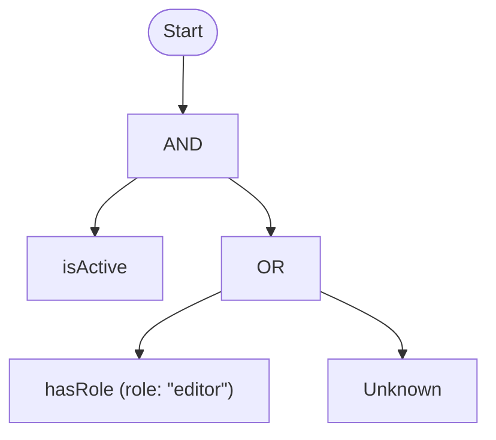

# Rule report

Source: `export.rule`, text, `sha256:590bb31f50f9feefafe055eccf71bc92439dd5d51a70c81db7886cdff905adf3`.

## Rule

```text
/* Active editors, or active users while the role service is down. */ isActive AND
(hasRole(role: "editor") OR Unknown)
```

## Equation

$`\text{isActive} \land (\text{hasRole(role: "editor")} \lor \text{U})`$

## Diagram



## Truth table

The Strong K3 truth table: every combination of `F`, `U` and `T` for the terms.

| isActive | hasRole(role: "editor") | Result |
| --- | --- | --- |
| F | F | F |
| F | U | F |
| F | T | F |
| U | F | U |
| U | U | U |
| U | T | U |
| T | F | U |
| T | U | U |
| T | T | T |

## Statistics

| Statistic | Value |
| --- | --- |
| Nodes | 5 |
| Depth | 3 |
| Terms | 2 (2 distinct) |
| Predicates | `hasRole`, `isActive` |
| Operators | `and` 1, `or` 1 |
| Variables | none |
| Data sources | none |
| BDD nodes | 7 |
| Constancy | Contingent |
| Truth table | 9 rows, 4 classical rows, within the cap |

## Analysis

The analysis found nothing to report.
